# Homeserver – Konzept

Schlankes, reproduzierbares Heimserver-System auf Debian 13: Docker-Container, Samba-Freigaben, Cockpit als Verwaltung, komplett per Ansible aufgesetzt und von einem eigenen USB-Installer installierbar.

> **Wie du dieses Dokument benutzt:** Lege es als `docs/KONZEPT.md` ins Repo. Abschnitt 12 (Roadmap) ist als Issue-Liste gedacht, jeder Meilenstein hat Abnahmekriterien. Stellen, die ich nicht ohne Test absichern konnte, sind mit **[VERIFY]** markiert und in Abschnitt 14 gesammelt.

---

## 1. Ziele und Nicht-Ziele

**Ziele**

- Ersatz für OpenMediaVault: nur das, was gebraucht wird (Docker, Samba, Platten, Updates, Weboberfläche).
- Alles Individuelle (Hostname, Benutzer, Shares, Dienste) in **einer** Konfigurationsdatei, nichts davon im Image oder im öffentlichen Repo.
- Neuinstallation vom USB-Stick in Minuten, wiederholbar und idempotent.
- Das Ergebnis soll später auch auf anderer Hardware (Rechner eines Freundes) laufen. Keine festen Geräte-IDs.
- Virtueller Desktop-Zugriff auf einen Server ohne Monitor (optional).

**Nicht-Ziele**

- Keine eigene Distribution, keine eigenen Paketquellen.
- Kein RAID/ZFS (eine Datenplatte, Backups statt Redundanz).
- Kein Zugriff aus dem Internet (Fernzugriff nur per VPN, siehe 10).
- Kein NFS, kein Portainer, keine Multi-User-Rechteverwaltung (nur ein Benutzer).
- Keine Datenmigration vom Altsystem (die Datenplatte wird neu formatiert).

## 2. Ausgangslage

| Punkt | Stand |
|---|---|
| CPU | AMD A4-5000 (4 Kerne, 2013, 15 W), x86_64 |
| RAM | 15 GiB |
| Boot | UEFI |
| Systemplatte | SSD, ca. 100 GB (`sdb` im Altsystem) |
| Datenplatte | HDD, ca. 3,6 TB (`sda` im Altsystem), wird neu formatiert |
| Altsystem | Debian 11 + OpenMediaVault (Sicherheitsupdates für Debian 11 sind ausgelaufen) |
| Dienste | SABnzbd, Sonarr, Radarr, Recommendarr, Emby, Scrutiny, PS2GameManager |
| Nutzer | ein Benutzer |

Konsequenzen der Hardware: Emby nur mit Direct Play (kein Transcoding), kein ZFS, ein Desktop nur schlank (XFCE).

> Die Gerätenamen `sda`/`sdb` sind **nicht stabil** und beim Altsystem genau umgekehrt zur Intuition (Daten = `sda`, System = `sdb`). Deshalb erkennt das System Platten nach Eigenschaften, nie nach Namen.

## 3. Architektur

```mermaid
flowchart LR
  subgraph A["Phase A: Installer"]
    ISO["Debian-netinst + preseed"] --> SEL["select-disk.sh<br/>wählt die SSD"]
    SEL --> BASE["Minimales Debian 13<br/>(SSH, git)"]
  end
  subgraph B["Phase B: homeserver-setup"]
    BASE --> DISK["Datenplatte wählen,<br/>formatieren, mounten"]
    DISK --> CFG["/etc/homeserver/config.yml"]
  end
  subgraph C["Phase C: Ansible (lokal)"]
    CFG --> R1["base"] --> R2["datastructure"] --> R3["docker"] --> R4["cockpit"] --> R5["samba"] --> R6["stacks"]
  end
  R6 --> RUN["Laufendes System:<br/>Cockpit :9090, Dockge :5001,<br/>Samba :445, Container"]
```



**Schichten**

| Schicht | Inhalt | Ändert sich |
|---|---|---|
| Image | Debian-Installer + Preseed + Auswahlskript | selten |
| Repo (öffentlich) | Ansible-Rollen, Compose-Vorlagen, Skripte, Defaults | oft |
| Host-Konfiguration | `/etc/homeserver/config.yml` | pro Maschine |
| Secrets | `ansible-vault` oder Dateien unter `/srv/data/configs/` | pro Maschine, nie im Repo |
| Daten | `/srv/data` auf der HDD | laufend |

**Grundsatz:** Das Image veraltet nie, weil es nur ein Minimalsystem installiert und alles Weitere aus dem Repo zieht.

## 4. Entscheidungen

| # | Thema | Entscheidung | Begründung |
|---|---|---|---|
| D1 | Basis | Debian 13 (Trixie), minimal | stabil, lange Updates, Cockpit und Samba in den Paketquellen |
| D2 | Verwaltung | Cockpit + 45Drives-Plugins (file-sharing, identities, navigator) | schlank, nutzt Systemdienste statt eigener Datenbank |
| D3 | Docker-UI | **Dockge** | arbeitet direkt auf `compose.yaml`-Dateien, die im Git-Repo liegen; Portainer speichert Stacks in eigener DB |
| D4 | Samba | nativ auf dem Host, per Cockpit gepflegt | Container-Samba brauchte `network_mode: host` und bringt hier keinen Vorteil |
| D5 | Konfiguration | Ansible, lokal ausgeführt (`-c local`) | idempotent, kein Server/Agent nötig |
| D6 | Dateisystem Daten | ext4 (Standard) oder XFS, per Variable | eine einzelne Platte, kein Bedarf für ZFS/Btrfs |
| D7 | Benutzer | ein Admin-Benutzer; Container laufen mit dessen UID/GID | keine Gruppen- und ACL-Logik nötig |
| D8 | Ordner | ein Mountpunkt `/srv/data` für alle \*arr-Apps | Hardlinks/atomare Moves statt Kopieren |
| D9 | Desktop | xrdp + XFCE (optional) | deutlich flüssiger als VNC; TigerVNC als Alternative |
| D10 | Fernzugriff | nur WireGuard/Tailscale | keine offenen Ports im Internet |
| D11 | Installer | offizielles netinst-ISO + Preseed, kein eigenes Distro-Build | geringer Pflegeaufwand |
| D12 | Swap | `atomic`-Recipe legt kleine Swap-Partition an, zusätzlich zram | zram hat höhere Priorität, beides stört sich nicht |
| D13 | Docker-Abhängigkeit | `RequiresMountsFor=/srv/data` am Docker-Dienst | verhindert, dass Container bei fehlender HDD ihre Configs auf die SSD schreiben |
| D14 | Scrutiny | übernimmt die SMART-Überwachung | `smartd` auf dem Host entfällt |

## 5. Repo-Struktur

```
homeserver/
├── README.md
├── LICENSE
├── .gitignore
├── .yamllint
├── .ansible-lint
├── config.example.yml
├── docs/
│   └── KONZEPT.md                    # dieses Dokument
├── bin/
│   └── homeserver-setup              # Phase B
├── installer/
│   ├── preseed.cfg.in                # Vorlage mit Platzhaltern
│   ├── select-disk.sh                # läuft im Debian-Installer
│   ├── build-iso.sh                  # baut das Installations-ISO
│   └── serve-preseed.sh              # Dev-Modus für VM-Tests
├── ansible/
│   ├── ansible.cfg
│   ├── site.yml
│   ├── group_vars/all.yml            # Defaults
│   └── roles/
│       ├── base/
│       ├── datastructure/
│       ├── docker/
│       ├── cockpit/
│       ├── samba/
│       ├── stacks/
│       ├── backup/                   # Phase 2
│       └── desktop/                  # optional
├── stacks/
│   ├── dockge/compose.yaml.j2
│   ├── arr/compose.yaml.j2
│   ├── emby/compose.yaml.j2
│   ├── scrutiny/compose.yaml.j2
│   └── ps2gamemanager/compose.yaml.j2
└── .github/
    └── workflows/lint.yml
```

**Konventionen**

- Repo **öffentlich**, deshalb keine Secrets, keine persönlichen Werte. `config.yml`, `.env`, `vault.yml` stehen in `.gitignore`.
- Branch `main` plus Feature-Branches, Releases als Tags (`v0.1.0`, ...). Der Installer verweist auf einen **Tag**, nicht auf `main`, damit ein Image reproduzierbar bleibt.
- Compose-Vorlagen enden auf `.j2`, damit Ansible sie rendern kann (Docker-Variablen `${DATA}` und Jinja `{{ }}` stören sich nicht).
- Alle Skripte: `set -euo pipefail`, `shellcheck`-sauber.

**Entwicklungsumgebung (VS Code)**

- Erweiterungen: *Ansible* (Red Hat), *YAML*, *ShellCheck*, *Docker*, *Markdown Preview Mermaid Support*.
- Testen in einer VM per **Remote-SSH**, nicht auf dem echten Server.
- Lokal: `python -m venv .venv && pip install ansible ansible-lint yamllint`.

## 6. Konfigurationsmodell

Drei Ebenen, spätere überschreiben frühere:

1. `ansible/group_vars/all.yml` (Defaults im Repo)
2. `/etc/homeserver/config.yml` (pro Maschine, wird von `homeserver-setup` erzeugt, per `-e @...` übergeben)
3. `ansible-vault` (Secrets, optional)

| Schlüssel | Typ | Default | Bedeutung |
|---|---|---|---|
| `hostname` | string | `nas` | Hostname und Samba-Servername |
| `admin_user` | string | `admin` | einziger Benutzer; UID/GID wird für Container ermittelt |
| `timezone` | string | `Europe/Berlin` | System und Container (`TZ`) |
| `data_mount` | path | `/srv/data` | Mountpunkt der Datenplatte |
| `data_fs` | `ext4`/`xfs` | `ext4` | vom Setup erkannt |
| `data_dirs` | list | siehe 8 | anzulegende Ordner unter `data_mount` |
| `shares` | list von `{name, path}` | `media` | Initiale Samba-Shares (Pfad relativ zu `data_mount`) |
| `stacks` | list | alle fünf | welche Stacks unter `/opt/stacks` entstehen und starten |
| `stack_configs` | map | siehe `all.yml` | Config-Unterordner je Stack unter `data_mount/configs` |
| `cockpit_plugins` | list | file-sharing, identities, navigator | zusätzliche Cockpit-Pakete |
| `backup.*` | map | aus | Phase 2, siehe 11 |
| `desktop.enabled` | bool | `false` | schaltet die Desktop-Rolle ein |

Beispiel `/etc/homeserver/config.yml`:

```yaml
hostname: nas
admin_user: nils
timezone: Europe/Berlin
data_mount: /srv/data
data_fs: ext4
shares:
  - name: media
    path: media
stacks: [dockge, arr, emby, scrutiny, ps2gamemanager]
```

## 7. Installationsablauf

### 7.1 Phase A: Installer

**Ziel:** USB-Stick booten, Fragen nach Hostname/Benutzer/Passwort beantworten, Systemplatte wird automatisch gefunden, einmal bestätigen, fertig.

**Ablauf**

1. Netinst-ISO bootet mit `auto=true priority=critical file=/cdrom/preseed.cfg`.
2. Alles Unkritische ist vorbelegt (Sprache, Tastatur, Zeitzone, Mirror, Pakete).
3. Nur diese Dinge werden abgefragt: Benutzername, Passwort, **Bestätigung vor dem Schreiben der Partitionstabelle**.
4. `partman/early_command` startet `select-disk.sh`:
   - schließt USB-/Wechseldatenträger aus (damit auch den Installationsstick),
   - schließt rotierende Platten aus (`queue/rotational` = 1),
   - schließt Platten mit Label `HSDATA` aus,
   - bleibt **genau ein** Kandidat übrig, wird er gesetzt (`partman-auto/disk`), sonst fragt der Installer selbst.
5. UEFI oder BIOS erkennt der Installer, das `atomic`-Recipe legt passend ESP bzw. BIOS-Boot an.
6. `late_command` klont das Repo nach `/opt/homeserver` und hängt einen Hinweis an `/etc/motd`.

**Sicherheitsregeln**

- Die Bestätigung vor dem Partitionieren bleibt **immer** manuell (`partman/confirm` wird nicht gesetzt).
- Der Installer fasst die Datenplatte nie an (nur Platten, die er als Kandidat führt, und nur die gewählte).
- Beim ersten Test wird die HDD abgezogen.

**Zwei Wege zum Preseed**

| Weg | Wann | Wie |
|---|---|---|
| Dev-Modus | VM-Tests, Entwicklung | `serve-preseed.sh` startet `python3 -m http.server`, Boot-Parameter `auto=true priority=critical url=http://<host>:8000/preseed.cfg` |
| ISO | Produktiv | `build-iso.sh` bettet Preseed und Skript ins ISO und ändert die Bootmenüs |

`preseed.cfg.in` enthält zwei Platzhalter: `@REPO_URL@` (Git-URL mit Tag) und `@EARLY_CMD@` (im ISO-Modus `sh /cdrom/select-disk.sh`, im Dev-Modus `wget -qO- http://<host>:8000/select-disk.sh | sh`). Vollständige Dateien: Anhang B bis D.

**Hinweise**

- Der Server hat keinen Monitor. Für die Installation einmal Monitor und Tastatur anschließen und im BIOS/UEFI USB als Boot-Medium wählen.
- Netinst lädt Pakete aus dem Netz, Internet ist beim Installieren Pflicht.
- Hostname, Domain und Benutzer werden danach vom Ansible-Lauf (`hostname`-Variable) endgültig gesetzt.

### 7.2 Phase B: `bin/homeserver-setup`

Interaktives Skript, einmal nach der Installation per SSH als `sudo` ausführen. **Idempotent.**

| Schritt | Verhalten |
|---|---|
| 1 | Root-Check, Pakete nachinstallieren (`ansible`, `git`, `parted`, `e2fsprogs`, `xfsprogs`) |
| 2 | Admin-Benutzer aus `SUDO_USER`, sonst Rückfrage; `root` ist verboten |
| 3 | Ist `data_mount` schon ein Mountpoint → Plattenschritt überspringen |
| 4 | Platten auflisten, **Systemplatte ausblenden**, Auswahl per Nummer |
| 5 | Eingehängte Platten werden abgelehnt |
| 6 | Existiert ein Dateisystem mit Label `HSDATA`: Frage, ob nur eingehängt oder neu formatiert wird |
| 7 | Formatieren erst nach **Eintippen des Gerätenamens** (z. B. `sda`), danach GPT + eine Partition + ext4/xfs mit Label `HSDATA` |
| 8 | fstab-Eintrag per **UUID** mit `nofail,x-systemd.device-timeout=10s` (xfs zusätzlich `inode64`), mounten |
| 9 | `/etc/homeserver/config.yml` schreiben, falls nicht vorhanden (bestehende wird nie überschrieben) |
| 10 | Repo unter `/opt/homeserver` finden (oder aus `HOMESERVER_REPO` klonen), `ansible-playbook` lokal starten |
| 11 | Samba-Passwort per `smbpasswd -a` setzen, falls der Benutzer noch fehlt |
| 12 | URLs ausgeben (Cockpit, Dockge, Samba-Pfad) |

**Abnahme:** zweiter Lauf ändert nichts und fragt nichts außer ggf. dem Samba-Passwort.

**Offen (optional):** Single-Disk-Modus für Rechner mit nur einer Platte (`data_mount` liegt dann auf der Systemplatte). Aktuell bricht Schritt 4 ab, wenn keine zweite Platte da ist.

### 7.3 Phase C: Ansible-Rollen

Aufruf (auch für spätere Änderungen):

```bash
cd /opt/homeserver/ansible
sudo ansible-playbook -i localhost, -c local site.yml -e @/etc/homeserver/config.yml
```

`site.yml` ermittelt zuerst UID/GID des Admin-Benutzers (`getent passwd`) und setzt `puid`/`pgid`. Reihenfolge der Rollen: `base`, `datastructure`, `docker`, `cockpit`, `samba`, `stacks`.

| Rolle | Aufgaben | Prüfung |
|---|---|---|
| **base** | Pakete (`sudo curl gnupg acl git rsync python3-debian unattended-upgrades systemd-zram-generator`), Radeon-Firmware nur auf AMD, Hostname, Zeitzone, automatische Sicherheitsupdates, zram | `unattended-upgrade --dry-run -d`, `zramctl` |
| **datastructure** | `assert`, dass `data_mount` ein Mountpoint ist; Ordnerstruktur aus `data_dirs` (0775), `configs/` (0750), alles `admin_user` | `ls -la /srv/data` |
| **docker** | offizielles Docker-Repo (deb822), Docker CE + Compose-Plugin, `daemon.json` mit Log-Rotation (10 MB × 3), Drop-in `RequiresMountsFor`, Admin in Gruppe `docker`, `flush_handlers` | `docker info`, `systemctl show docker -p RequiresMountsFor` |
| **cockpit** | `cockpit`, `cockpit-storaged`, `cockpit-packagekit`; 45Drives-Repo, Plugins; NFS-Dienst abschalten (wird als Abhängigkeit mitinstalliert); `cockpit.socket` aktiv | `https://<host>:9090` |
| **samba** | `samba`; `smb.conf` **einmalig** aus Template (Marker `# homeserver-managed`, Original wird gesichert); `smbd` an, `nmbd` aus | `testparm -s`, Zugriff von Windows |
| **stacks** | Scrutiny-Geräteliste aus Facts; `/opt/stacks/<name>/` mit `compose.yaml` und `.env`; Config-Ordner; `docker compose up -d` pro Stack | `docker ps` |

**Wichtige Regeln**

- **`smb.conf` gehört nach dem ersten Lauf dir.** Ansible überschreibt sie nicht. In Cockpit im Samba-Tab einmal *Import configuration from /etc/samba/smb.conf* ausführen, danach pflegst du Shares dort. Das Plugin arbeitet mit der Samba-Registry.
- **Samba ohne NetBIOS** (`disable netbios = yes`): Zugriff über `\\nas\media`, der Server erscheint nicht automatisch in der Windows-Netzwerkumgebung.
- **Handler vor den Stacks ausführen** (`meta: flush_handlers` in der Docker-Rolle), sonst startet Docker nach dem Start der Container noch einmal neu.

## 8. Datenlayout und Rechte

```
/srv/data/                      (Mountpoint der HDD, Label HSDATA)
├── usenet/
│   ├── nzb/
│   ├── incomplete/
│   └── complete/
├── media/
│   ├── music/
│   ├── books/
│   ├── games/
│   ├── movies/
│   └── tv/
└── configs/                    (nicht per Samba freigegeben)
    ├── radarr/  sonarr/  sabnzbd/  recommendarr/
    ├── emby/
    ├── scrutiny/{config,influxdb}/
    └── ps2gamemanager/
```

**Regeln**

1. Sonarr, Radarr und SABnzbd bekommen das ganze `/srv/data` als **ein** Volume (`${DATA}:/data`), SABnzbd nur `${DATA}/usenet:/data/usenet`. Nur dann liegen Download und Bibliothek im selben Dateisystem und Hardlinks funktionieren. In den Apps zählen die Container-Pfade (`/data/usenet/...`, `/data/media/...`).
2. Emby bekommt `media/` **mit Schreibrechten** (Cover, Metadaten).
3. Alle Dateien gehören dem Admin-Benutzer. Container laufen mit `PUID`/`PGID` dieses Benutzers (Emby: `UID`/`GID`).
4. `configs/` hat Modus 0750 und wird nicht freigegeben. Zugriff nur per SSH oder Cockpit Navigator.
5. Mountoptionen: `defaults,nofail,x-systemd.device-timeout=10s` (+ `inode64` bei XFS). `nofail` hält das System bootfähig, `RequiresMountsFor` (D13) hält dafür Docker an.

**Hardlink-Test (nach dem Aufbau):**

```bash
touch /srv/data/usenet/complete/t
ln /srv/data/usenet/complete/t /srv/data/media/tv/t
stat -c %h /srv/data/media/tv/t    # erwartet: 2
rm /srv/data/usenet/complete/t /srv/data/media/tv/t
```

## 9. Docker-Stacks

Pro Stack ein Ordner `/opt/stacks/<name>/` mit `compose.yaml` (aus Vorlage gerendert) und `.env`:

```
DATA=/srv/data
PUID=<uid des Admins>
PGID=<gid des Admins>
TZ=Europe/Berlin
```

| Stack | Dienste | Besonderheit |
|---|---|---|
| `dockge` | Dockge | Docker-Socket und `/opt/stacks` gemountet |
| `arr` | Radarr, Sonarr, SABnzbd, Recommendarr | `depends_on` mit Healthcheck, deshalb in einem Stack |
| `emby` | Emby | Port 8097 → 8096, `media` beschreibbar |
| `scrutiny` | Scrutiny (omnibus) | Geräteliste wird beim Rendern aus den erkannten Platten erzeugt |
| `ps2gamemanager` | PS2GameManager | ganze Datenplatte als `/nas`, wahlweise nur `media/games` |

**Portplan** (alle nur im LAN):

| Port | Dienst |
|---|---|
| 22 | SSH |
| 445 | Samba |
| 3000 | Recommendarr |
| 3389 | xrdp (optional, nur localhost, per SSH-Tunnel) |
| 5001 | Dockge |
| 7878 | Radarr |
| 8080 | SABnzbd |
| 8088 | Scrutiny |
| 8097 | Emby |
| 8420 | PS2GameManager |
| 8989 | Sonarr |
| 9090 | Cockpit |

Änderungen gegenüber dem Altsystem:

- SABnzbd-Port **9090 entfällt** (kollidiert mit Cockpit).
- Scrutiny-Port **8086** (InfluxDB-Admin) wird nicht mehr veröffentlicht.
- Emby-Volume ist nicht mehr `:ro`.
- JDownloader entfällt.
- Zeitzone war `Europe/Amsterdam`, jetzt Variable (Default `Europe/Berlin`).
- Recommendarr: `env_file` mit `required: false`. Die `.env` mit API-Keys legst du selbst unter `/srv/data/configs/recommendarr/` an.
- Log-Rotation global in `daemon.json`, die `logging:`-Blöcke entfallen.

Vollständige Vorlagen: Anhang E.

## 10. Netzwerk und Sicherheit

- **Kein Port-Forwarding** am Router. Fernzugriff nur per WireGuard oder Tailscale.
- **Docker umgeht Host-Firewalls:** Veröffentlichte Container-Ports (`ports:`) sind trotz ufw erreichbar, weil Docker eigene iptables-Regeln setzt. Wer das braucht, schützt über die `DOCKER-USER`-Kette oder bindet Ports an eine Adresse (`127.0.0.1:...`). Im LAN ohne Internetzugang von außen ist das für den Anfang akzeptabel.
- **Dockge hat Zugriff auf den Docker-Socket** und ist damit praktisch root-äquivalent. Nur im LAN erreichbar lassen.
- **Cockpit** ist ein Root-Zugang per Browser (Login mit Systembenutzer). Nur LAN/VPN.
- **SSH:** nach dem ersten Login Schlüssel hinterlegen, danach Passwort-Login abschalten (`PasswordAuthentication no`). Als spätere Rolle `ssh-hardening` vorgesehen.
- **Samba:** mindestens SMB3, `map to guest = never`, eigenes Samba-Passwort (nicht das Login-Passwort).
- **Updates:** `unattended-upgrades` für Debian-Sicherheitsupdates. Container-Images aktualisierst du bewusst über Dockge (Pull + Redeploy), kein Auto-Update.
- **Supply Chain:** Das 45Drives-Skript wird zur Laufzeit von `repo.45drives.com` geladen und ausgeführt. Vorher lesen, Version im Repo festhalten.

## 11. Backup und Wiederherstellung (Phase 2, Rolle `backup`)

**Warum wichtig:** Die HDD ist ohne Redundanz ein Single Point of Failure, und auch `configs/` (Einstellungen von Sonarr, Radarr, Emby, ...) liegt auf ihr. Medien sind ersetzbar, die Konfiguration nicht ohne Weiteres.

**Konzept**

| Punkt | Festlegung |
|---|---|
| Werkzeug | `restic` |
| Sicherungsziel | **anderes Medium** als die HDD (externe Platte, SFTP/Storage Box, Cloud). Ein Repository auf derselben HDD schützt nicht vor Plattenausfall |
| Gesichert | `/srv/data/configs`, `/opt/stacks`, `/etc/homeserver`, `/etc/fstab`, `/etc/samba/smb.conf` |
| Nicht gesichert | `media/`, `usenet/` |
| Ausschlüsse | Emby-Cache und Transcode-Ordner **[VERIFY]** genaue Namen unter `configs/emby` prüfen |
| Zeitplan | systemd-Timer, täglich nachts (`OnCalendar=*-*-* 03:30`), `Persistent=true` |
| Aufbewahrung | `--keep-daily 7 --keep-weekly 4 --keep-monthly 6`, danach `restic forget --prune` |
| Passwort | Datei `/etc/homeserver/restic-password` (Modus 0600), **zusätzlich** an einem sicheren Ort außerhalb des Servers |
| Konsistenz | SQLite-Datenbanken der \*arr-Apps sind im laufenden Betrieb nicht garantiert konsistent. Zusätzlich zu restic deren eingebaute Sicherungen (`/config/Backups`) aktiv lassen, die liegen mit unter `configs/` |
| Variablen | `backup.repository`, `backup.password_file`, `backup.schedule` |

**Abnahme:** Wiederherstellung wurde einmal komplett getestet (VM: Configs aus dem Repository zurückspielen, Stacks starten, Dienste laufen mit den alten Einstellungen).

## 12. Roadmap (als GitHub-Issues anlegen)

Jeder Meilenstein ist so geschnitten, dass er in der VM testbar ist.

### M0 – Repo-Grundlage
- [ ] Repo anlegen, `LICENSE` (z. B. MIT), `.gitignore`, `README.md`
- [ ] `docs/KONZEPT.md` einchecken
- [ ] `.yamllint`, `.ansible-lint` (mit `profile: min` starten und später verschärfen)
- [ ] GitHub-Workflow `lint.yml` (Anhang D)
- [ ] `config.example.yml`, `group_vars/all.yml`

**Abnahme:** CI ist grün auf leerem Gerüst.

### M1 – Ansible-Kern (VM mit vorab gemounteter zweiter Platte)
- [ ] `site.yml` mit UID/GID-Ermittlung
- [ ] Rolle `base`
- [ ] Rolle `datastructure` (inkl. Mountpoint-`assert`)
- [ ] Rolle `docker` (Repo, Log-Rotation, `RequiresMountsFor`)

**Abnahme:** Zweiter Playbook-Lauf meldet `changed=0`. `docker info` zeigt Log-Rotation. Ohne Datenplatte startet Docker nicht, SSH bleibt erreichbar.

### M2 – Cockpit und Samba
- [ ] Rolle `cockpit` inkl. 45Drives-Repo und Plugins, NFS aus
- [ ] Rolle `samba` mit einmaliger `smb.conf`
- [ ] Prüfen: Cockpit-Import der Shares, Zugriff von Windows

**Abnahme:** Share `media` ist von Windows beschreibbar, Dateien gehören dem Admin-Benutzer. **[VERIFY]** Plugins auf Trixie installierbar.

### M3 – Stacks
- [ ] Vorlagen für alle fünf Stacks (Anhang E)
- [ ] Rolle `stacks` inkl. Scrutiny-Geräteliste
- [ ] Hardlink-Test (Abschnitt 8)

**Abnahme:** Alle Dienste über ihre Ports erreichbar, Hardlink-Test liefert `2`, Scrutiny zeigt beide Platten.

### M4 – `homeserver-setup`
- [ ] Skript nach Abschnitt 7.2
- [ ] `shellcheck` sauber
- [ ] Test: leere Platte, vorhandenes `HSDATA`, bereits gemountet (Idempotenz)

**Abnahme:** Szenarien 1, 6 und 8 aus der Testmatrix (Abschnitt 13) bestanden.

### M5 – Installer
- [ ] `select-disk.sh` (Anhang B)
- [ ] `preseed.cfg.in` (Anhang C), Dev-Modus mit `serve-preseed.sh`
- [ ] `build-iso.sh` (Anhang D), UEFI und BIOS
- [ ] Alle Szenarien der Testmatrix

**Abnahme:** Szenarien 1 bis 5 bestanden, Datenplatte wurde in keinem Szenario angefasst.

### M6 – Backup-Rolle
- [ ] Rolle `backup` nach Abschnitt 11
- [ ] Restore-Test

### M7 – Optional: Desktop und Härtung
- [ ] Rolle `desktop` (xrdp + XFCE, nur localhost)
- [ ] Rolle `ssh-hardening`
- [ ] Single-Disk-Modus im Setup
- [ ] ISO-Build per GitHub-Actions bei Tag, ISO als Release-Asset

### M8 – Umstellung auf dem echten Server
Runbook in Abschnitt 15.

## 13. Tests

### 13.1 Testmatrix (VM)

| # | Boot | Platten | Erwartung |
|---|---|---|---|
| 1 | UEFI | 1 SSD (System) + 1 leere HDD (Daten) | Installer wählt die SSD automatisch, Setup formatiert die HDD |
| 2 | BIOS | wie 1 | wie 1, GRUB auf der SSD |
| 3 | UEFI | nur 1 Platte | Setup bricht mit klarer Meldung ab (bis Single-Disk-Modus existiert) |
| 4 | UEFI | 2 SSDs | Installer **fragt**, welche Platte |
| 5 | UEFI | NVMe-System + SATA-Daten | Gerätenamen `nvme0n1`/`p`-Suffix werden korrekt behandelt |
| 6 | beliebig | Setup zweimal ausführen | zweiter Lauf ändert nichts |
| 7 | beliebig | Neustart ohne Datenplatte | Docker bleibt aus, SSH und Cockpit gehen, keine Dateien landen unter `/srv/data` auf der SSD |
| 8 | beliebig | Datenplatte mit vorhandenem Label `HSDATA` | Setup bietet "nur einhängen" an und formatiert nicht ungefragt |

**Hinweis zu VMs:** In virtuellen Maschinen ist das Merkmal `rotational` oft unzuverlässig (virtio meldet Platten teils als rotierend). Für SSD-Emulation bei IDE/SCSI-Platten den Parameter `rotation_rate=1` am Gerät setzen **[VERIFY]**. Notfalls für den Test die Auswahl bewusst dem Installer überlassen (Szenario 4).

Beispiel mit QEMU (UEFI, zwei Platten) **[VERIFY]**:

```bash
qemu-img create -f qcow2 sys.qcow2 20G
qemu-img create -f qcow2 data.qcow2 50G
qemu-system-x86_64 -enable-kvm -m 4096 -smp 2 \
  -bios /usr/share/ovmf/OVMF.fd \
  -device ahci,id=ahci \
  -drive if=none,id=sys,file=sys.qcow2 -device ide-hd,drive=sys,bus=ahci.0,rotation_rate=1 \
  -drive if=none,id=data,file=data.qcow2 -device ide-hd,drive=data,bus=ahci.1 \
  -cdrom homeserver-installer.iso -boot d \
  -nic user,hostfwd=tcp::2222-:22
```

### 13.2 Abnahme auf dem echten Server

- [ ] Alle Ports aus Abschnitt 9 antworten, Cockpit und Dockge laden
- [ ] Share `media` von Windows aus les- und schreibbar
- [ ] Hardlink-Test liefert `2`
- [ ] Emby schreibt Cover und Metadaten
- [ ] Scrutiny listet beide Platten
- [ ] Nach Neustart laufen alle Container von selbst
- [ ] Ohne HDD (Kabel ab, Neustart) bleibt Docker aus, SSH geht
- [ ] `unattended-upgrade --dry-run -d` läuft ohne Fehler
- [ ] Restore-Test der Backups (nach M6)

### 13.3 CI

GitHub-Workflow (Anhang D): `shellcheck`, `yamllint`, `ansible-lint`, `ansible-playbook --syntax-check`. Das reicht für statische Prüfungen. Funktionstests (Installer, Rollen) laufen manuell in der VM, ein vollautomatischer Test wäre ein späterer Ausbau.

## 14. Risiken und offene Verifikationen

| Punkt | Risiko | Gegenmaßnahme |
|---|---|---|
| 45Drives-Pakete auf Debian 13 | Pakete sind für Ubuntu gebaut, Hersteller bestätigt Debian-Kompatibilität nur für ältere Versionen | M2 früh in der VM testen. Fallback: Plugins aus den GitHub-Releases installieren oder auf Cockpit ohne Plugin und Samba-Konfiguration per Datei ausweichen |
| `cockpit-identities`, `-navigator` auf Trixie | Paket evtl. nicht auffindbar | Liste in `cockpit_plugins` anpassbar |
| `signed_by` mit URL im Docker-Repo | Ansible-Version abhängig | Alternativ Schlüssel nach `/etc/apt/keyrings/docker.asc` laden und Pfad angeben |
| Preseed-Fragen erzwingen (`seen false`) | Verhalten je Frage unterschiedlich | im Installer-Test (M5) kontrollieren, welche Fragen erscheinen |
| `grub-installer/bootdev` | GRUB könnte auf die falsche Platte | `select-disk.sh` setzt es auf die gewählte Platte, in BIOS-Szenario 2 prüfen |
| Bootmenü-Dateien im Debian-13-ISO | Pfade (`isolinux/`, `boot/grub/grub.cfg`) können sich ändern | `build-iso.sh` bricht ab, wenn eine erwartete Datei fehlt |
| `rotational` in VMs | Fehlerkennung der SSD | siehe 13.1 |
| Emby-Verzeichnisnamen für Backup-Ausschlüsse | falsche Ausschlüsse | vor Phase 2 im laufenden Container nachsehen |
| Samba-Registry und Cockpit-Import | Nach Import gelten Änderungen in Cockpit, nicht mehr in der Datei | gewollt, im README dokumentieren |
| Debian-Installer-ISO-Neuveröffentlichung | `build-iso.sh` nimmt ein beliebiges netinst-ISO | Dateiname und SHA256 im Skript prüfen lassen |

## 15. Umstellung auf dem echten Server (Runbook)

Es werden **keine Daten migriert**. Notiere vorher nur Zugangsdaten, die du neu eingeben musst:

- [ ] Usenet-Provider (Server, Port, Zugang) für SABnzbd
- [ ] Indexer und deren API-Keys für Sonarr und Radarr
- [ ] Emby-Konto/Premiere-Zugang und die Bibliotheken, die du neu anlegen willst
- [ ] API-Keys aus der Recommendarr-`.env`
- [ ] Wunschwerte, die du im Altsystem eingestellt hattest (Qualitätsprofile, Pfade)

**Ablauf**

1. Installations-ISO auf USB-Stick schreiben.
2. Monitor und Tastatur anschließen, im UEFI von USB booten.
3. Installer durchlaufen. **Wenn die automatische Auswahl nicht eindeutig die SSD trifft, die Auswahl selbst prüfen.** Die HDD wird dabei nicht angefasst, beim ersten Mal sicherheitshalber abziehen.
4. Neustart, per SSH als Admin-Benutzer anmelden.
5. `sudo /opt/homeserver/bin/homeserver-setup`: HDD auswählen, mit Gerätenamen bestätigen, Samba-Passwort setzen.
6. Cockpit öffnen, Shares per *Import* übernehmen.
7. In Dockge die Stacks prüfen, Dienste neu konfigurieren (Indexer, Download-Client, Bibliotheken).
8. Abnahmeliste aus 13.2 durchgehen.
9. Backup-Ziel einrichten (M6), erst dann gilt das System als fertig.

---

## Anhang A: Gerüst der Defaults (`ansible/group_vars/all.yml`)

```yaml
---
hostname: nas
admin_user: admin
timezone: Europe/Berlin

data_mount: /srv/data
data_fs: ext4
stacks_dir: /opt/stacks

data_dirs:
  - usenet
  - usenet/nzb
  - usenet/incomplete
  - usenet/complete
  - media
  - media/music
  - media/books
  - media/games
  - media/movies
  - media/tv

shares:
  - name: media
    path: media

stacks: [dockge, arr, emby, scrutiny, ps2gamemanager]

stack_configs:
  dockge: []
  arr: [radarr, sonarr, sabnzbd, recommendarr]
  emby: [emby]
  scrutiny: [scrutiny/config, scrutiny/influxdb]
  ps2gamemanager: [ps2gamemanager]

cockpit_plugins:
  - cockpit-file-sharing
  - cockpit-identities
  - cockpit-navigator
```

Die Elternordner stehen in `data_dirs` bewusst einzeln, damit Besitzer und Rechte sicher überall gesetzt werden.

## Anhang B: `installer/select-disk.sh`

Läuft in der Busybox-Shell des Debian-Installers (nur POSIX-`sh`, keine Bash-Funktionen, kein `lsblk`).

```sh
#!/bin/sh
# Wählt die Systemplatte: genau ein Kandidat -> automatisch, sonst fragt der Installer.
cands=""
for d in /sys/block/*; do
  n=${d##*/}
  case "$n" in loop*|ram*|sr*|zram*|md*|dm-*|fd*) continue ;; esac
  [ "$(cat "$d/removable" 2>/dev/null)" = 1 ] && continue          # Wechseldatenträger
  case "$(readlink -f "$d")" in *usb*) continue ;; esac            # USB (auch der Installationsstick)
  [ "$(cat "$d/queue/rotational" 2>/dev/null)" = 0 ] || continue   # nur SSD/NVMe
  if command -v blkid >/dev/null 2>&1 \
     && blkid 2>/dev/null | grep "^/dev/$n" | grep -q 'LABEL="HSDATA"'; then
    continue                                                       # Datenplatte
  fi
  cands="$cands $n"
done
set -- $cands
if [ "$#" -eq 1 ]; then
  debconf-set partman-auto/disk "/dev/$1"
  debconf-set grub-installer/bootdev "/dev/$1"
fi
```

**[VERIFY]** `blkid` im Installer vorhanden? Wenn nicht, entfällt die Label-Prüfung (SSD-Filter greift trotzdem).

## Anhang C: `installer/preseed.cfg.in`

```
### Lokalisierung
d-i debian-installer/locale string de_DE.UTF-8
d-i keyboard-configuration/xkb-keymap select de
d-i time/zone string Europe/Berlin
d-i clock-setup/utc boolean true
d-i clock-setup/ntp boolean true

### Netzwerk und Mirror
d-i netcfg/choose_interface select auto
d-i netcfg/get_hostname string nas
d-i netcfg/get_domain string local
d-i mirror/country string manual
d-i mirror/http/hostname string deb.debian.org
d-i mirror/http/directory string /debian
d-i mirror/http/proxy string

### Konten: root gesperrt, Benutzer wird abgefragt
d-i passwd/root-login boolean false
d-i passwd/make-user boolean true
d-i passwd/user-fullname seen false
d-i passwd/username seen false
d-i passwd/user-password seen false
d-i passwd/user-password-again seen false

### Partitionierung
# partman-auto/disk wird von select-disk.sh gesetzt, sonst fragt der Installer
d-i partman/early_command string @EARLY_CMD@
d-i partman-auto/select_disk seen false
d-i partman-auto/method string regular
d-i partman-auto/choose_recipe select atomic
d-i partman-lvm/device_remove_lvm boolean true
d-i partman-md/device_remove_md boolean true
d-i partman-partitioning/confirm_write_new_label boolean true
d-i partman/choose_partition select finish
# partman/confirm wird bewusst NICHT gesetzt: Bestätigung bleibt manuell

### Pakete
d-i apt-setup/non-free-firmware boolean true
tasksel tasksel/first multiselect ssh-server, standard
d-i pkgsel/include string git sudo ca-certificates
d-i pkgsel/upgrade select full-upgrade
popularity-contest popularity-contest/participate boolean false

### Bootloader
d-i grub-installer/only_debian boolean true
d-i grub-installer/with_other_os boolean false

### Abschluss: Repo klonen, Hinweis hinterlegen
d-i preseed/late_command string \
  in-target git clone @REPO_URL@ /opt/homeserver ; \
  in-target sh -c 'echo "Einrichten mit: sudo /opt/homeserver/bin/homeserver-setup" >> /etc/motd'
d-i finish-install/reboot_in_progress note
```

`@REPO_URL@` ist die Git-URL **mit Tag** (`git clone --branch v0.1.0 <url>`), `@EARLY_CMD@` je nach Modus siehe 7.1. **[VERIFY]** Welche der mit `seen false` markierten Fragen tatsächlich erscheinen.

## Anhang D: `installer/build-iso.sh` (Skizze), `serve-preseed.sh`, CI

**`build-iso.sh`**

```bash
#!/usr/bin/env bash
set -euo pipefail
ISO_IN=${1:?Pfad zum debian-13.x-amd64-netinst.iso}
ISO_OUT=${2:-homeserver-installer.iso}
REPO_URL=${REPO_URL:?git-URL inkl. --branch <tag>}
WORK=$(mktemp -d); trap 'rm -rf "$WORK"' EXIT

sed -e "s|@REPO_URL@|--branch ${TAG:?} ${REPO_URL}|" \
    -e "s|@EARLY_CMD@|sh /cdrom/select-disk.sh|" \
    installer/preseed.cfg.in > "$WORK/preseed.cfg"
cp installer/select-disk.sh "$WORK/select-disk.sh"

# Bootmenüs holen und um einen Auto-Eintrag erweitern
xorriso -osirrox on -indev "$ISO_IN" \
  -extract /boot/grub/grub.cfg "$WORK/grub.cfg" \
  -extract /isolinux/txt.cfg "$WORK/txt.cfg" 2>/dev/null || {
    echo "Erwartete Bootmenü-Dateien fehlen im ISO, Skript anpassen." >&2; exit 1; }

PARAMS='auto=true priority=critical file=/cdrom/preseed.cfg'
# UEFI (GRUB): neuen Eintrag an den Anfang, Timeout kurz
{ printf 'set default=0\nset timeout=5\n'
  printf 'menuentry "Homeserver automatisch installieren" {\n'
  printf '  linux /install.amd/vmlinuz %s --- quiet\n  initrd /install.amd/initrd.gz\n}\n' "$PARAMS"
  cat "$WORK/grub.cfg"; } > "$WORK/grub.new"
# BIOS (isolinux): ebenso
{ printf 'label homeserver\n  menu label ^Homeserver automatisch installieren\n  kernel /install.amd/vmlinuz\n'
  printf '  append vga=788 initrd=/install.amd/initrd.gz %s --- quiet\n' "$PARAMS"
  cat "$WORK/txt.cfg"; } > "$WORK/txt.new"

xorriso -indev "$ISO_IN" -outdev "$ISO_OUT" \
  -map "$WORK/preseed.cfg"     /preseed.cfg \
  -map "$WORK/select-disk.sh"  /select-disk.sh \
  -map "$WORK/grub.new"        /boot/grub/grub.cfg \
  -map "$WORK/txt.new"         /isolinux/txt.cfg \
  -boot_image any replay
```

**[VERIFY]** Pfade und Kernelnamen (`/install.amd/...`) im Debian-13-ISO prüfen, Bootmenü-Syntax im VM-Test kontrollieren. `-boot_image any replay` erhält die Hybrid-Bootfähigkeit (UEFI und BIOS).

**`serve-preseed.sh`** (Dev-Modus)

```bash
#!/usr/bin/env bash
set -euo pipefail
HOST_IP=${1:?IP des Entwicklungsrechners}
TAG=${TAG:-main}
OUT=$(mktemp -d)
sed -e "s|@REPO_URL@|--branch ${TAG} ${REPO_URL:?}|" \
    -e "s|@EARLY_CMD@|wget -qO- http://${HOST_IP}:8000/select-disk.sh \| sh|" \
    installer/preseed.cfg.in > "$OUT/preseed.cfg"
cp installer/select-disk.sh "$OUT/"
echo "Boot-Parameter: auto=true priority=critical url=http://${HOST_IP}:8000/preseed.cfg"
cd "$OUT" && python3 -m http.server 8000
```

**`.github/workflows/lint.yml`**

```yaml
name: lint
on: [push, pull_request]
jobs:
  lint:
    runs-on: ubuntu-latest
    steps:
      - uses: actions/checkout@v4
      - run: sudo apt-get update && sudo apt-get install -y shellcheck yamllint
      - run: pip install ansible ansible-lint
      - run: shellcheck bin/homeserver-setup installer/*.sh
      - run: yamllint -d relaxed ansible config.example.yml
      - run: cd ansible && ansible-lint
      - run: cd ansible && ansible-playbook -i localhost, site.yml --syntax-check -e @../config.example.yml
```

`yamllint` bewusst nur auf `ansible/` und die Beispielkonfiguration, die `.j2`-Vorlagen sind kein reines YAML.

## Anhang E: Compose-Vorlagen

Alle Dateien liegen als `stacks/<name>/compose.yaml.j2`. Nur `dockge` und `scrutiny` enthalten Jinja, die anderen sind reines Compose mit `${...}`-Variablen aus der `.env`.

**dockge**

```yaml
services:
  dockge:
    container_name: dockge
    image: louislam/dockge:1
    restart: unless-stopped
    ports:
      - 5001:5001
    volumes:
      - /var/run/docker.sock:/var/run/docker.sock
      - ./data:/app/data
      - {{ stacks_dir }}:{{ stacks_dir }}
    environment:
      - DOCKGE_STACKS_DIR={{ stacks_dir }}
```

**arr**

```yaml
services:
  radarr:
    container_name: radarr
    image: ghcr.io/hotio/radarr:latest
    restart: unless-stopped
    ports: ["7878:7878"]
    environment: [PUID=${PUID}, PGID=${PGID}, TZ=${TZ}]
    volumes:
      - ${DATA}/configs/radarr:/config
      - ${DATA}:/data
    healthcheck:
      test: ["CMD", "curl", "-f", "http://localhost:7878/ping"]
      interval: 10s
      timeout: 5s
      retries: 12
      start_period: 30s

  sonarr:
    container_name: sonarr
    image: ghcr.io/hotio/sonarr:latest
    restart: unless-stopped
    ports: ["8989:8989"]
    environment: [PUID=${PUID}, PGID=${PGID}, TZ=${TZ}]
    volumes:
      - ${DATA}/configs/sonarr:/config
      - ${DATA}:/data
    healthcheck:
      test: ["CMD", "curl", "-f", "http://localhost:8989/ping"]
      interval: 10s
      timeout: 5s
      retries: 12
      start_period: 30s

  sabnzbd:
    container_name: sabnzbd
    image: ghcr.io/hotio/sabnzbd:latest
    restart: unless-stopped
    ports: ["8080:8080"]
    environment: [PUID=${PUID}, PGID=${PGID}, TZ=${TZ}]
    volumes:
      - ${DATA}/configs/sabnzbd:/config
      - ${DATA}/usenet:/data/usenet

  recommendarr:
    container_name: recommendarr
    image: ghcr.io/d-a-w-n/recommendarr:latest
    restart: unless-stopped
    depends_on:
      radarr: {condition: service_healthy}
      sonarr: {condition: service_healthy}
    env_file:
      - path: ${DATA}/configs/recommendarr/.env
        required: false
    ports: ["3000:3000"]
    volumes:
      - ${DATA}/configs/recommendarr:/data
```

**emby**

```yaml
services:
  emby:
    container_name: emby
    image: emby/embyserver:latest
    restart: unless-stopped
    environment: [UID=${PUID}, GID=${PGID}, TZ=${TZ}]
    ports: ["8097:8096"]
    volumes:
      - ${DATA}/configs/emby:/config
      - ${DATA}/media:/media
```

**scrutiny** (Jinja für die Geräteliste)

```yaml
services:
  scrutiny:
    container_name: scrutiny
    image: ghcr.io/analogj/scrutiny:master-omnibus
    restart: unless-stopped
    cap_add: [SYS_RAWIO]
    ports: ["8088:8080"]
    volumes:
      - /run/udev:/run/udev:ro
      - ${DATA}/configs/scrutiny/config:/opt/scrutiny/config
      - ${DATA}/configs/scrutiny/influxdb:/opt/scrutiny/influxdb
    devices:

      - {{ d }}

```

Die Geräteliste kommt in der Rolle `stacks` aus den Ansible-Facts:

```yaml
scrutiny_devices: >-
  {{ ansible_devices | dict2items
     | rejectattr('key', 'match', '^(loop|ram|sr|zram|dm-|md)')
     | selectattr('value.removable', 'equalto', '0')
     | map(attribute='key')
     | map('regex_replace', '^', '/dev/')
     | sort | list }}
```

Bei NVMe-Platten braucht Scrutiny zusätzlich `SYS_ADMIN`.

**ps2gamemanager**

```yaml
services:
  ps2gamemanager:
    container_name: ps2gamemanager
    image: ghcr.io/d-a-w-n/ps2gamemanager:latest
    restart: unless-stopped
    ports: ["8420:8420"]
    environment: [PUID=${PUID}, PGID=${PGID}, TZ=${TZ}]
    volumes:
      # ganze Datenplatte wie bisher; für weniger Rechte: ${DATA}/media/games:/nas
      - ${DATA}:/nas
      - ${DATA}/configs/ps2gamemanager:/config
```

## Anhang F: Optionale Rolle `desktop` (Spezifikation)

Aktiviert über `desktop.enabled: true`.

- Pakete: `xfce4`, `xrdp`, `dbus-x11` (kein `task-xfce-desktop`, das ist unnötig groß für diese CPU).
- `xrdp`-Benutzer in Gruppe `ssl-cert`.
- Pro Benutzer `~/.xsession` mit `startxfce4`.
- **Nur lokal lauschen** (xrdp-Option `address=127.0.0.1` in `[Globals]`, **[VERIFY]**), Zugriff per SSH-Tunnel: `ssh -L 3389:localhost:3389 admin@nas`, danach RDP-Client auf `localhost`.
- Alternative: TigerVNC mit `vncserver` als systemd-User-Dienst, ebenfalls nur über Tunnel. VNC ist langsamer und ohne Verschlüsselung, deshalb nur zweite Wahl.
- Abnahme: Anmeldung per RDP, Desktop startet, Cockpit-Terminal und `htop` zeigen moderate Last.
