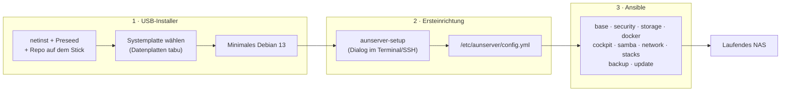

# aunserver – Projektplan

Ein USB-Stick, der jederzeit ein fertiges NAS installiert: aktuelles Debian, Docker mit Verwaltung und Überwachung, Samba-Freigaben per Weboberfläche, Servarr-Medienstack (Usenet), Netzwerk-Apps und eine sichere Grundkonfiguration.

Stand: 2026-10-19 · Status: im Betrieb auf dem echten NAS (`v0.9.0` + Updates), Abnahme bis auf PS2/OPL erledigt

---

## 1. Ziele und Nicht-Ziele

**Ziele**

1. **USB-Stick → laufendes NAS** in unter 30 Minuten, mit wenigen Fragen und ohne Handarbeit danach.
2. **Docker verwalten und überwachen** über eine Weboberfläche: Stacks starten, stoppen, aktualisieren, Logs ansehen, Ressourcen und Alarme.
3. **Samba sehr leicht verwalten:** Freigaben per Klick im Browser anlegen, ändern, löschen.
4. **Medien verwalten:** vollständiger Servarr-Stack für Usenet und Emby als Media-Server.
5. **Netzwerk-Apps:** VPN-Fernzugriff, DNS-Werbeblocker, Reverse Proxy mit Namen statt Ports, Startseite.
6. **Platten- und Systemüberwachung** mit Benachrichtigung.
7. **Aktuell:** stabile Basis, aber aktuelle Software dort, wo es zählt (Docker, Cockpit, Kernel optional, alle Apps).
8. **Sicher per Default:** nichts aus dem Internet erreichbar, Zugriff nur aus dem LAN oder per VPN.
9. **Hardware-unabhängig:** keine festen Gerätenamen, läuft auf dem eigenen NAS, in einer VM und bei Freunden.

**Nicht-Ziele**

- Keine eigene Distribution, keine eigenen Paketquellen.
- Kein RAID/ZFS in Version 1 (siehe offene Frage O3).
- Keine Portfreigaben im Router, kein öffentliches Hosting.
- Keine Torrents (Entscheidung: nur Usenet).
- Keine Request-Oberfläche (Seerr o. ä.), dafür kommt später eine eigene Lösung.
- Keine Mehrbenutzer-Rechteverwaltung in Version 1 (ein Admin, Samba-Benutzer per Weboberfläche).

## 2. Grundentscheidungen

| # | Thema | Entscheidung | Begründung |
|---|---|---|---|
| D1 | Basis-OS | **Debian 13 „Trixie“** (aktuell 13.7), minimal | Volle Unterstützung bis 08/2028, LTS bis 06/2030. Stabil, Samba und Cockpit sind in den Paketquellen. |
| D2 | „Möglichst aktuell“ | Basis stabil, Aktualität über **Docker CE aus dem Upstream-Repo**, **Cockpit aus trixie-backports**, optional **Backports-Kernel** (neue Hardware), alle Apps als Container | Ein Rolling Release als NAS-Basis bringt Bruchrisiko ohne echten Nutzen, denn die Apps laufen ohnehin in Containern. |
| D3 | Installer | Offizielles **netinst-ISO plus Preseed**, umgebaut zu einem eigenen ISO, das Repo liegt auf dem Stick | Pakete kommen beim Installieren frisch vom Mirror, der Stick veraltet also nicht. Das Repo auf dem Stick macht den Ablauf unabhängig von GitHub. |
| D4 | Konfiguration | **Ansible lokal** (`-c local`), eine Datei `/etc/aunserver/config.yml` | Idempotent, jederzeit erneut ausführbar, kein Agent nötig. |
| D5 | Verwaltungsoberfläche | **Cockpit** (System, Platten, Updates, Terminal) mit Plugins **file-sharing** (Samba), **navigator** (Dateien), **identities** (Benutzer) | Läuft auf dem Host und bleibt deshalb erreichbar, auch wenn Docker nicht läuft. |
| D6 | Samba | **Weboberfläche ist führend** (Cockpit file-sharing, Samba-Registry). Ansible legt nur Grundkonfiguration und Start-Shares an und überschreibt danach nichts mehr | Gewünscht: „sehr leicht verwalten“. Wiederherstellbar durch Backup des Registry-Exports (`net conf list`). |
| D7 | Docker-Verwaltung | **Arcane** (geändert am 2026-10-18, vorher Dockge) | Dockge ohne Release seit 03/2025; Arcane aktiv gepflegt, Compose-Stacks unter `/opt/stacks`, Logs, Ressourcen, Image-Updates. |
| D8 | Stacks | Mitgelieferte Stacks rendert Ansible aus Vorlagen nach `/opt/stacks/<name>`. **Eigene Stacks** legst du frei in Arcane an, Ansible fasst sie nie an | Klare Grenze zwischen „gehört dem Projekt“ und „gehört dir“. |
| D9 | Monitoring | **Beszel** (Host und Container: CPU, RAM, Netz, Temperaturen, Alarme), **Scrutiny** (SMART), **Dozzle** (Logs), **ntfy** (Push-Benachrichtigung) | Alles leichtgewichtig, auch für schwache NAS-CPUs geeignet. |
| D10 | Zugriff auf Web-Apps | **Caddy** als Reverse Proxy, alle Apps unter `https://<app>.<domain>`. Caddy und AdGuard laufen im **Host-Netzwerk**, alle anderen Container veröffentlichen Ports nur an `127.0.0.1` | Docker öffnet selbst keinen Port ins LAN, die Host-Firewall entscheidet allein (Spikes S3/S4). |
| D11 | DNS | **AdGuard Home** als DNS für das Heimnetz, mit Rewrite `*.<domain>` → NAS-IP | Werbeblocker und lokale Namen in einem Dienst. |
| D12 | Fernzugriff | **Tailscale** auf dem Host. WireGuard (wg-easy) war als Alternative vorgesehen, ist aber nicht umgesetzt (`apps.wireguard` bleibt `false`) | Tailscale braucht keine Portfreigabe und verteilt auch den DNS (Split DNS für `nas.home.arpa`). |
| D13 | Image-Versionen | **Feste Tags** in `roles/stacks/defaults`, **Renovate** erzeugt Update-PRs im Repo (montags, eigene Images `ghcr.io/d-a-w-n/*` sofort); Patch/Minor merged Renovate nach grüner CI selbst, Major entscheidet der Nutzer | Reproduzierbar, Updates bleiben trotzdem einfach; aufs NAS kommt nichts unbeaufsichtigt (D20). |
| D14 | Sprache | Deutsch (Doku, Skriptausgaben, Kommentare) | wie bisher |
| D15 | Media-Server | **Emby** | Wird heute schon genutzt. |
| D16 | App-Configs | **SSD** (`/srv/appdata`), Sicherung per restic | Schnelle SQLite-Zugriffe, die HDD darf schlafen, Configs überleben einen HDD-Ausfall. |
| D17 | HTTPS im LAN | Lokale Domain `nas.home.arpa`, Caddy mit eigener CA (`tls internal`) | Keine eigene Domain nötig. Das Stammzertifikat wird einmal pro Gerät installiert. |
| D18 | Zielhardware | AMD A4-5000, 15 GiB RAM, SSD + 3,6-TB-HDD, UEFI | Kein Transcoding: Emby nur mit Direct Play, Monitoring bewusst leichtgewichtig. |
| D19 | SMB1 für PS2/OPL | **Zweite Samba-Instanz** `smbd-legacy`: nur SMB1, eigener Port (1445), eigene Benutzerdatenbank mit Benutzer `ps2`, nur der PS2-Ordner, Firewall optional auf die IP der Konsole beschränkt. Freigaben über `config.yml`, nicht über Cockpit | SMB1 gilt in Samba global; die Hauptinstanz bleibt so bei SMB3. Das schwache NTLMv1 trifft nur ein eigenes Konto ohne Login (Spike S5). |
| D20 | Updates des NAS | **`aunserver-update`** holt den Stand von `main` (GitHub-Tarball, Commit per `export-subst` in `COMMIT`), vorher Backup, danach Setup; täglicher Check meldet per ntfy, installiert wird per Hand (entschieden 2026-10-18) | Jeder Merge in `main` hat den VM-Test bestanden; Renovate-Updates kommen so ohne eigenes Release an, aber nie unbeaufsichtigt. |

## 3. Architektur



**Schichten**

| Schicht | Inhalt | Ändert sich |
|---|---|---|
| USB-Image | Debian-Installer, Preseed, Plattenauswahl, Kopie des Repos | selten |
| Repo | Ansible-Rollen, Compose-Vorlagen, Skripte, Defaults | oft |
| Host-Konfiguration | `/etc/aunserver/config.yml` und Secrets | pro Maschine |
| Laufzeitdaten | App-Configs, Samba-Registry, eigene Stacks | laufend (Backup!) |
| Nutzdaten | Medien, Downloads, Freigaben | laufend |

## 4. Funktionsumfang

### 4.1 Plattform (immer installiert)

| Dienst | Zweck | Ort |
|---|---|---|
| Cockpit + file-sharing, navigator, identities | System, Platten, Updates, Samba, Dateien, Benutzer | Host, `:9090` |
| Samba (+ `wsdd2`) | Freigaben, NAS taucht in der Windows-Netzwerkumgebung auf | Host, `:445` |
| Samba-Legacy *(optional)* | SMB1-Freigabe für PS2/OPL (D19) | Host, `:1445` |
| Docker CE + Compose | Container-Laufzeit | Host |
| Caddy | Reverse Proxy, HTTPS | Container, `:80/:443` |
| Arcane | Stacks verwalten | Container |
| Homepage | Startseite mit allen Diensten und Status | Container |
| docker-socket-proxy | Nur-Lese-Zugriff auf Docker für Homepage, Dozzle und Beszel | Container |

### 4.2 Überwachung

| Dienst | Zweck |
|---|---|
| Beszel (Hub + Agent) | Host- und Container-Metriken, Verlauf, Alarme (CPU, RAM, Platte voll, Temperatur) |
| Scrutiny | SMART-Werte aller Platten, Warnung vor Ausfall |
| Dozzle | Container-Logs live im Browser |
| ntfy | Push aufs Handy für Beszel, Scrutiny, Backup-Fehler und Updates |
| Uptime Kuma *(optional)* | Erreichbarkeit der Dienste prüfen |

### 4.3 Medien (Servarr, nur Usenet)

| Dienst | Zweck |
|---|---|
| Prowlarr | Indexer zentral für alle \*arr-Apps |
| SABnzbd | Usenet-Download (entpackt selbst, Unpackerr ist nicht nötig) |
| Sonarr | Serien |
| Radarr | Filme |
| Lidarr | Musik |
| Bazarr | Untertitel |
| Recyclarr | Qualitätsprofile nach TRaSH Guides, automatisch synchronisiert |
| Emby | Media-Server (Direct Play, Medienordner beschreibbar für Cover und Metadaten) |
| Bücher *(optional)* | Readarr ist eingestellt; Audiobookshelf und/oder Calibre-Web als Ersatz, siehe O6 |
| **Recommendarr** *(eigene App)* | Empfehlungen auf Basis von Sonarr/Radarr; Compose-Datei vom Nutzer übernommen |
| **PS2GameManager** *(eigene App)* | Verwaltung der PS2-Spiele im OPL-Ordner (`games/ps2`); Compose-Datei vom Nutzer übernommen, eigener Stack `ps2`, zusätzlich im Netz `media_default` (für SABnzbd) |

### 4.4 Netzwerk

| Dienst | Zweck |
|---|---|
| AdGuard Home | DNS fürs Heimnetz, Werbeblocker, lokale Namen |
| Tailscale | Fernzugriff ohne Portfreigabe; per Split DNS fragen Tailscale-Geräte AdGuard nach `nas.home.arpa` (Weg für Router ohne DNS-Einstellung) |
| Caddy | siehe 4.1 |

Jeder Dienst lässt sich in `config.yml` einzeln ein- und ausschalten:

```yaml
apps:
  adguard: true
  tailscale: true
  wireguard: false
  uptime_kuma: false
  emby: true

# SMB1-Freigaben für PS2/OPL (D19), Pfade relativ zu /srv/data
samba_legacy:
  enabled: true
  port: 1445
  allowed_clients: []         # z. B. [192.168.1.50] = nur die PS2
  shares:
    - name: PS2SMB
      path: games/ps2
```

## 5. Datenlayout

Ausgerichtet an den TRaSH Guides. **Ein** Dateisystem für Downloads und Medien, damit Hardlinks und sofortige Verschiebungen funktionieren.

```
/srv/data/                  HDD, Label AUNDATA
├── usenet/
│   ├── incomplete/
│   └── complete/{tv,movies,music}/
├── media/{tv,movies,music,books}/
├── games/ps2/              OPL-Struktur (CD, DVD, VMC, CFG, ART, …), Gruppe ps2share, nur per SMB1-Instanz
└── shares/                 freie Samba-Freigaben (Dokumente, Fotos, …)

/srv/appdata/               SSD: Configs und Datenbanken aller Container
/opt/stacks/                SSD: compose.yaml und .env pro Stack
```

**Regeln**

- Sonarr, Radarr und Lidarr sehen `/srv/data` als `/data`, SABnzbd sieht nur `/data/usenet`.
- Alle Container laufen mit `PUID`/`PGID` des Admins und `umask 002`.
- Configs liegen auf der **SSD** (D16) und werden per restic gesichert.
- Die Datenplatte wird per **Label `AUNDATA`** mit `nofail` eingehängt (Ansible; `aunserver-setup` formatiert und beschriftet nur). Zwei Platten mit diesem Label → Abbruch statt Raten. Docker startet nur mit eingehängter Platte (`RequiresMountsFor`), und der leere Mountpoint bekommt `chattr +i`. So landet nichts versehentlich auf der SSD.
- Standard-Freigaben: `media` (lesen und schreiben) und `shares`. Weitere legst du in Cockpit an.

## 6. Sicherheit

Grundsatz: **Nichts ist aus dem Internet erreichbar.** Zugriff gibt es nur aus dem LAN oder über VPN.

| Bereich | Maßnahme |
|---|---|
| Firewall | nftables, Default **drop** eingehend. Aus dem LAN: 22, 53, 80, 443, 445, 9090 (+ 3702 TCP/UDP für wsdd2, 5355 UDP für LLMNR), Emby 8096 TCP, 7359 und 1900 UDP (SSDP/DLNA), dazu SSDP-Antworten der `emby_dlna_renderers` (UDP 32768–60999, z. B. Sonos für „Wiedergabe auf“). Über Tailscale (`tailscale0`): 22, 53, 80, 443, 445, 9090 und Emby 8096. Tailscale selbst: UDP 41641. Port 1445 (SMB1) nur aus dem LAN, nie per VPN, auf Wunsch nur von der PS2-IP |
| SMB1 | Nur in der getrennten Legacy-Instanz (D19), nur der PS2-Ordner, eigenes Konto `ps2` ohne Shell und mit eigenem Passwort |
| Docker vs. Firewall | Container-Ports nur an `127.0.0.1`, Zugriff ausschließlich über Caddy (Host-Netzwerk). Zusätzlich verwirft eine forward-Regel neue DNAT-Verbindungen aus LAN/VPN zu Containern, damit auch ein versehentlich auf `0.0.0.0` veröffentlichter Port zu bleibt. Eigene nftables-Tabelle, nie `flush ruleset` (S4) |
| Docker-Socket | Homepage, Dozzle und Beszel nur über **socket-proxy (read-only)**. Arcane braucht den vollen Socket, ist root-gleich und deshalb nur hinter Caddy aus dem LAN erreichbar |
| SSH | nur Schlüssel (`ssh_authorized_keys` in der Config), kein Root-Login; Passwort-Login nach der Einrichtung aus, sofern ein Schlüssel hinterlegt ist (sonst bleibt er an, Hinweis im Setup) |
| Brute-Force | fail2ban für SSH (optional, Default an) |
| Konten | Root gesperrt, ein Admin mit sudo, eigenes Samba-Passwort |
| Samba | mindestens SMB3, Signing an, kein Gast-Zugriff, keine `configs`-Freigabe |
| Web-Apps | HTTPS über Caddy. Servarr-Apps mit eigener Anmeldung (Admin + Web-Passwort); Apps ohne eigenes Login (SABnzbd, Bazarr, Dozzle, Scrutiny, Recommendarr, PS2GameManager) hinter Caddy-Passwort, Dozzle übernimmt den Benutzer (forward-proxy). Optional später zentrales Login (TinyAuth/Authelia), siehe O5 |
| Updates | `unattended-upgrades` für Debian **und** Docker-Repo, Neustartfenster konfigurierbar (Default 04:00, nur bei Bedarf). Container-Images und aunserver selbst per Renovate-PR → `main` → `aunserver-update` (D20); nicht in Arcane aktualisieren, das nächste Setup würde zurückdrehen |
| Secrets | nie im Repo; `config.yml`, `.env`, `*.secret` in `.gitignore`, gitleaks in der CI |
| Kernel/System | AppArmor (Debian-Default) aktiv, `sysctl`-Baseline (z. B. `kernel.dmesg_restrict`, keine ICMP-Redirects) |
| Supply Chain | Image-Tags gepinnt, Fremd-Repos (Docker, 45Drives, Tailscale) mit Schlüssel im Repo, keine `curl \| sh`-Installation |

## 7. Installationsablauf

### 7.1 USB-Stick erstellen

`installer/build-iso.sh` lädt das aktuelle Debian-13-netinst-ISO, prüft die SHA256-Summe und baut daraus `aunserver-<version>.iso` mit:

- Preseed-Datei und Bootmenü-Eintrag „aunserver installieren“ (UEFI und BIOS),
- `select-disk.sh` für die Plattenauswahl,
- dem Repo als Archiv (`aunserver-installer/aunserver.tar.gz`, Commit in `COMMIT`).

Danach schreibst du das ISO mit `dd`, GNOME Disks, balenaEtcher oder Rufus (DD-Modus) auf den Stick; Ventoy ist nicht getestet. Fertige ISOs baut die CI bei jedem Release-Tag (`release.yml`).

### 7.2 Installation (am Gerät, Monitor und Tastatur einmalig nötig)

1. Vom Stick booten, „aunserver installieren“ wählen.
2. Abgefragt werden nur: **Benutzername** (Vorschlag `nasadmin`, `admin` ist in Debian reserviert) und **Passwort**. Den Hostnamen setzt `aunserver-setup`.
3. `select-disk.sh` sucht die Systemplatte. Ausgeschlossen werden USB-Geräte, Wechselmedien und Platten mit Label `AUNDATA`. Gibt es genau eine SSD/NVMe, fragt das Skript mit Modell, Größe und Seriennummer nach. Sonst (oder bei „Nein“) fragt der Installer und zeigt Modell und Größe.
4. **Die Bestätigung vor dem Partitionieren bleibt immer manuell.**
5. `late_command` kopiert das Repo nach `/opt/aunserver` und richtet den Hinweis für den ersten Login ein.

### 7.3 Ersteinrichtung: `aunserver-setup`

Ein Dialog (whiptail) direkt am Gerät oder per SSH, idempotent und jederzeit erneut ausführbar:

1. Datenplatte wählen (Systemplatte wird ausgeblendet). Bei vorhandenem `AUNDATA` wird nur eingehängt, sonst formatiert, aber erst **nach Eintippen des Gerätenamens**. Single-Disk-Modus, falls nur eine Platte da ist.
2. Hostname, Domain für lokale Namen (Default `nas.home.arpa`), Zeitzone, SSH-Schlüssel.
3. Apps auswählen (Checkliste, Defaults wie in 4.4).
4. `config.yml` schreiben, Ansible ausführen.
5. Samba-Passwort setzen, Tailscale-Login-Link anzeigen.
6. Zugangsübersicht (`/etc/aunserver/zugaenge.txt`): Startseite `https://home.<domain>`, Cockpit `https://<ip>:9090`, DNS-Hinweis, Passwörter, Tailscale-Schritte, Backup.

Optional: Backup-Ziel (`--backup-repo`) und `--restore` für eine Neuinstallation aus einem vorhandenen Backup (M8).

**Danach im Browser:** AdGuard als DNS im Router eintragen (oder Split DNS in Tailscale, siehe BETRIEB.md), Caddy-Stammzertifikat einmal auf den Geräten installieren (Link auf der Startseite), Indexer in Prowlarr, Usenet-Server in SABnzbd, Bibliotheken in Emby.

## 8. Repo-Struktur

```
aunserver/
├── README.md
├── CLAUDE.md                    # Regeln für Claude-Sessions (Gitflow)
├── COMMIT                       # git archive trägt den Commit ein (export-subst, D20)
├── config.example.yml
├── docs/
│   ├── PLAN.md                  # dieses Dokument
│   ├── spikes.md                # Ergebnisse der Vorab-Tests
│   └── BETRIEB.md               # Bedienung, Updates, Wiederherstellung
├── installer/
│   ├── build-iso.sh
│   ├── preseed.cfg.in
│   ├── select-disk.sh
│   └── aunserver-login.sh       # Login-Hinweis aufs Setup
├── bin/
│   ├── aunserver-setup
│   └── aunserver-update
├── ansible/
│   ├── site.yml
│   ├── group_vars/all.yml       # Defaults der config.yml
│   ├── filter_plugins/          # arr_from_schema
│   └── roles/
│       ├── base/                # Pakete, Zeitzone, zram, Updates, Backports
│       ├── security/            # SSH, nftables, fail2ban, sysctl
│       ├── storage/             # Mount per Label, Ordner, chattr
│       ├── docker/
│       ├── cockpit/
│       ├── samba/               # Grundkonfiguration, wsdd2, Start-Shares, SMB1-Instanz
│       ├── network/             # Tailscale
│       ├── stacks/              # rendert stacks/* nach /opt/stacks, gepinnte Images in defaults/
│       ├── backup/              # restic + Timer + ntfy bei Fehler
│       └── update/              # aunserver-update im Pfad, täglicher Check
├── stacks/
│   ├── proxy/                   # caddy
│   ├── dns/                     # adguard
│   ├── socket-proxy/            # Nur-Lese-Zugriff auf Docker
│   ├── dashboard/               # homepage, arcane
│   ├── monitoring/              # beszel, scrutiny, dozzle, ntfy, uptime-kuma
│   ├── media/                   # prowlarr, sabnzbd, *arr, bazarr, recyclarr, emby, recommendarr
│   ├── ps2/                     # ps2gamemanager
│   └── zugaenge.txt.j2          # Zugangsübersicht
├── dev/
│   ├── vm-test.sh               # QEMU-Testmatrix
│   ├── vm-ansible.sh            # Repo in die VM, Playbook ausführen
│   └── preseed-dev.cfg
├── renovate.json
└── .github/workflows/
    ├── lint.yml                 # shellcheck, yamllint, ansible-lint, Renovate-Validator, gitleaks
    ├── vm-test.yml              # Dev-ISO bauen, installieren, Setup zweimal, Backup/Restore (UEFI + BIOS); Job vm-test = Pflicht-Check
    ├── iso-cache.yml            # Debian-ISO im Cache von main
    └── release.yml              # ISO bauen bei Tag
```

## 9. Meilensteine

Risikobasiert: Unklares wird zuerst in der VM geprüft. Jeder Meilenstein ist in der VM testbar und hat Abnahmekriterien.

### M0 – Gerüst ✅
- [x] Repo-Struktur, README, `.gitignore`, Lizenz
- [x] Lint-CI (shellcheck, yamllint, ansible-lint `production`, gitleaks), Versionen gepinnt (ansible-core 2.19 wie in Debian 13)
- [x] `dev/vm-test.sh` (QEMU, UEFI/BIOS, mehrere virtuelle Platten)
- [x] Renovate-Konfiguration (GitHub-App muss einmal aktiviert werden)

**Abnahme:** CI grün, VM startet mit netinst.

### M1 – Spikes (Wegwerfcode, Ergebnisse in `docs/spikes.md`)
- [x] **S1** Cockpit-Plugins (file-sharing, navigator, identities) auf Debian 13 installierbar? Samba-Registry funktioniert? → Ja, Pakete von GitHub-Releases (gepinnt), NFS/rpcbind maskieren; Details in [spikes.md](spikes.md). Freigabe per Klick auf dem echten Server bestätigt (2026-10-19).
- [x] **S2** Preseed: Welche Fragen erscheinen? Bleibt die Partitionsbestätigung manuell? Läuft `select-disk.sh` in der Installer-Busybox? → Ja; Hostname nicht abfragbar, `admin` reserviert; Entwürfe in `installer/` (BIOS offen)
- [x] **S3** AdGuard auf Port 53, Caddy mit `tls internal` und Wildcard-Namen → läuft im Host-Netzwerk, AdGuard per API einrichtbar (UI auf `127.0.0.1:8083`), Caddyfile als Ordner mounten
- [x] **S4** Docker-Ports an `127.0.0.1` und nftables → nur die freigegebenen Ports offen; forward-Regel schließt die Docker-Lücke
- [x] **S5** SMB1 für PS2/OPL neben SMB3 → zweite Samba-Instanz (D19)

**Abnahme:** Jede Annahme bestätigt oder das Design angepasst. Fallback für S1: Plugins aus GitHub-Releases, sonst ein schlankes eigenes Samba-Webformular als späteres Teilprojekt.

### M2 – Basis-System und Sicherheit ✅
- [x] `site.yml`, Rollen `base`, `security`, `docker`
- [x] Backports-Kernel optional (`kernel_backports: false`)
- [x] Idempotenz-Test in der CI: echte KVM-VM per Preseed installieren, Playbook zweimal, zweiter Lauf `changed=0` (`.github/workflows/vm-test.yml`)
- [x] Dev-Werkzeuge: `dev/vm-test.sh autoinstall` (ohne Eingaben), `dev/vm-ansible.sh` (Playbook in der VM)

**Abnahme:** SSH nur mit Schlüssel (laufender sshd bietet nur `publickey`), root abgewiesen, Firewall-Tabelle neben Dockers Tabellen auch nach Neustart des nftables-Dienstes, sysctl/zram/Auto-Updates (inkl. Docker-Repo) aktiv, alles nach Reboot unverändert; zweiter Lauf ohne Änderungen. Getestet am 2026-10-18 auf frisch installierter VM.

**Befunde:** `force_handlers = True` nötig (nach einem Abbruch gingen Handler verloren, sshd/sysctl blieben unwirksam). Das Docker-Repo hat kein `codename`-Feld, unattended-upgrades braucht `archive=`. Einmal trat direkt nach dem ersten Reboot `changed=1` auf, nicht reproduzierbar; beobachten.

### M3 – Speicher und Samba ✅
- [x] Rolle `storage` (Mount per Label, Ordner, `chattr +i`, Single-Disk-Modus)
- [x] Rollen `cockpit` (Backports, Plugins gepinnt mit SHA256, alle NFS-Dienste maskiert) und `samba` (Registry-Modus, wsdd2, Start-Shares, Samba-Passwort)
- [x] Legacy-Instanz für PS2 (D19, Spike S5), Ordnerstruktur für OPL, Gruppe `ps2share`

**Abnahme (VM, 2026-10-18):** Von außen durch die Firewall getestet: SMB3-Schreiben als Admin ✅, SMB1 an 445 abgelehnt ✅, Gast abgelehnt ✅, `ps2` an der Hauptinstanz abgelehnt ✅, SMB1-Schreiben als `ps2` in `DVD/` ✅, SMB3 an 1445 abgelehnt ✅, Admin an der PS2-Instanz abgelehnt ✅. Neue Registry-Freigabe (wie Cockpit) sofort erreichbar und vom nächsten Playbook-Lauf unberührt ✅. Nach Reboot lauschen nur 22, 445, 1445, 3702, 5355, 9090 ✅. **Testmatrix 7:** ohne Datenplatte Boot in 18 s, Status `running`, Docker und PS2-Instanz aus, SSH/Cockpit an, leerer Mountpoint selbst für root schreibgeschützt ✅; mit Platte kommt alles von selbst zurück ✅.

**Auf dem echten Server (M9):** Freigabe per Klick in Cockpit ✅ · PS2 mit OPL (S5) noch offen.

**Befunde:** `smbd` übernimmt geänderte `smb ports` nur bei Neustart, nicht bei reload (Port 139 blieb offen). `cockpit-file-sharing` zieht mehr NFS-Dienste mit als in S1 gesehen (Port 2049 und RPC-Ports), jetzt alle maskiert. wsdd2 nutzt TCP 3702 (nicht 5357). Gerätenamen wechseln auch zwischen zwei Boots derselben VM (`sdb` → `sda`).

### M4 – Plattform-Stacks ✅
- [x] socket-proxy, proxy (Caddy), dns (AdGuard), dashboard (Homepage, Arcane), monitoring (Beszel, Scrutiny, Dozzle, ntfy, optional Uptime Kuma)
- [x] Zugangsdaten automatisch erzeugt (`/etc/aunserver/secrets/`), Übersicht in `/etc/aunserver/zugaenge.txt`
- [x] AdGuard, Beszel (Benutzer, System, Alarme, ntfy) und Cockpit hinter Caddy ohne Klicks eingerichtet
- [x] Renovate erkennt alle Image-Tags der Stacks

**Abnahme (VM, 2026-10-18):** DNS löst `nas.home.arpa` und `*.nas.home.arpa` auf die NAS-IP auf, Werbung → `0.0.0.0` ✅. Stammzertifikat per HTTP abholbar, alle Apps per HTTPS mit dieser CA ✅. Dozzle/Scrutiny nur mit Web-Passwort ✅. Socket-Proxy: lesen 200, Container stoppen 403 ✅. Cockpit-WebSocket über Caddy und direkt über `:9090`, fremder Origin 403 ✅. **Alarmkette:** Scrutiny-Test → ntfy ✅; Beszel-Agent gestoppt → nach 2 min „Connection to nas is down“ über ntfy, nach Start „is up“ ✅. Reboot: alle 10 Container zurück ✅. Zweiter Lauf `changed=0` ✅.

**Auf dem echten Server (M9):** ntfy-App am Handy über Tailscale empfängt die Meldungen ✅ (O8).

**Befunde:** socket-proxy braucht `/tmp` als tmpfs bei `read_only`. `docker.sock:ro` schützt nicht vor API-Schreibzugriffen (Beszel-Beispiel). Cockpit `Origins` ersetzt die Standardregel (direkter Zugriff war sonst kaputt). Beszel: Erstbenutzer hat Rolle `user` und bekommt dann keine Alarme an interne Ziele; Einstellungen werden beim Anlegen durch Vorgaben ersetzt; Fehler landen nur im internen Log (`/api/logs`), nicht auf der Konsole. Arcane-Erstzugang `arcane`/`arcane-admin` mit erzwungenem Wechsel (Quellcode geprüft).

### M5 – Medien-Stack ✅
- [x] Compose-Dateien für Recommendarr und PS2GameManager vom Nutzer übernommen (feste Versionen, Ports nur an 127.0.0.1)
- [x] Stack `media` (Prowlarr, SABnzbd, Sonarr, Radarr, Lidarr, Bazarr, Recyclarr, Emby, Recommendarr) und Stack `ps2` (PS2GameManager)
- [x] Apps per API verbunden: SABnzbd-Ordner/Kategorien, Anmeldung (Admin + Web-Passwort), Bibliotheksordner, SABnzbd als Download-Client, Sonarr/Radarr/Lidarr in Prowlarr
- [x] Recyclarr mit TRaSH „[German] HD Bluray + WEB“ (Deutsch + DL, 1080p), **x265 (HD) +500** (Wunsch: platzsparend)
- [x] Hardlink-Test (Download → Bibliothek liefert Linkzähler 2)

**Abnahme (VM, 2026-10-18):** Verbindungstests Sonarr/Radarr/Lidarr → SABnzbd 200, Prowlarr-Anwendungen 200, Bibliotheksordner erreichbar, API ohne Schlüssel 401 ✅. Profile mit x265 +500, German DL 11000, German 10000 ✅. Hardlink 2 ✅. PS2GameManager läuft als `1000:ps2share` mit umask 002; App und SMB1-Konto `ps2` können die Dateien des jeweils anderen bearbeiten ✅. HTTPS: Servarr-Apps mit eigener Anmeldung, SABnzbd/Bazarr/PS2GameManager/Recommendarr (kein eigenes Login, Auskunft des Nutzers) mit Web-Passwort ✅. Abspielgerät Kodi spielt HEVC direkt ab (x265-Bonus passt). Reboot: 20/20 Container ✅. Zweiter Lauf `changed=0` ✅.

**Von Hand (bewusst):** Usenet-Server in SABnzbd, Indexer in Prowlarr, Emby-Konto und Bibliotheken.
**Bazarr:** per API mit Sonarr/Radarr verbunden (SignalR live), Sprachprofil „Deutsch + Englisch“ als Standard für neue Serien/Filme; wird nur angelegt, solange kein Profil existiert (Bazarr löscht beim Speichern nicht mitgeschickte Profile). Untertitel-Anbieter trägt der Nutzer ein.
**Auf dem echten Server (M9):** Download über SABnzbd mit echtem Usenet-Zugang ✅ (84 MB/s).

**Befunde:** Emby 4.11.x sind Vorabversionen, Prowlarr/Bazarr-Tags „latest“ sind Nightly/Develop → stabile Releases über die GitHub-Releases von linuxserver ermittelt. SABnzbd: Die eingebauten Kategorien `tv`/`movies` verloren nach der Einrichtung ihren Ordner wieder (CI und lokal nachgestellt, neu angelegte Kategorien blieben stabil) → eigene Kategorien `sonarr`/`radarr`/`lidarr` mit Ordnern `tv`/`movies`/`music`, danach kontrollierter Neustart und Prüfung, dass gespeichert ist. Kategorien mit Ordner nur gezielt abfragbar (`get_config&section=categories&keyword=<Name>`), Löschen per API nicht möglich. Grenze: Bekommt SABnzbd einen neuen API-Schlüssel, werden bestehende Download-Clients nicht angepasst. Deprecation-Warnung `warnings` an `exit_json` (relevant ab ansible-core 2.23): Quelle war `ansible.posix.mount`, in M8 durch eigene fstab-Pflege ersetzt, seitdem keine Warnungen. `host_whitelist` kommt als Liste. Der Entrypoint von PS2GameManager `chown`t `/config` auf PUID:PGID. x265 bei 1080p: in der deutschen TRaSH-Wertung neutral (0), nicht geblockt. Hinweis: x265 braucht HEVC-fähige Abspielgeräte, der A4-5000 kann HEVC nicht umwandeln.

### M6 – Ersteinrichtung `aunserver-setup` ✅
- [x] `bin/aunserver-setup`: Dialoge (whiptail) oder alle Antworten als Parameter (`--help`), schreibt `/etc/aunserver/config.yml` (0600), startet das Playbook, zeigt die Zugänge
- [x] Datenplatte: Systemplatte, USB und Wechselmedien werden nie angeboten; Formatieren nur nach Eintippen des Gerätenamens und (im Dialog) einer Zusammenfassung; **formatiert wird erst, wenn alle Angaben vollständig sind**
- [x] Wiederholbar: vorhandene `config.yml` und Platte mit Label `AUNDATA` werden weiterverwendet; Single-Disk-Modus
- [x] CI testet den echten Weg: Szenario 1 (leere HDD) → Setup mit Parametern formatiert und richtet ein → zweiter Lauf `changed=0`

**Abnahme (VM, 2026-10-18):** Systemplatte als Datenplatte, falsche Bestätigung und fehlendes `--format` abgelehnt, Platte unverändert ✅. Fehlendes Passwort bricht ab, **bevor** formatiert wird ✅. Erster Lauf: Platte formatiert (GPT, ext4, 1 % Reserve), alles eingerichtet (20 Container) ✅; zweiter Lauf erkennt Konfiguration und Platte, `changed=0` ✅. Dialoge per pexpect durchgespielt: Abbruch mit Escape ändert nichts, zu kurzes Passwort wird abgelehnt, falsch eingetippter Gerätename ändert nichts, kompletter Weg bis zum Formatieren ✅. Setup-Log nur für root ✅.

**Befunde:** Erste Fassung formatierte vor den übrigen Fragen (Abbruch hätte eine gelöschte, nicht eingerichtete Platte hinterlassen). Ohne gesetztes `TERM` kann whiptail nicht zeichnen (Skript bricht dann sauber ab). GitHub-Actions ohne `shell: bash` laufen ohne `pipefail` (`| tee` überdeckte Fehler). Mit `live-restore` laufen Container weiter, wenn Docker gestoppt wird.

### M7 – USB-Installer ✅
- [x] `installer/build-iso.sh`: aus dem offiziellen Debian-13-netinst-ISO (SHA256 gegen die Debian-Prüfsummen geprüft) ein ISO mit Bootmenü-Eintrag „aunserver installieren“ (UEFI und BIOS), Preseed, Plattenauswahl und dem Repo als Archiv; `md5sum.txt` wird fortgeschrieben. Ohne xorriso baut es automatisch in einem Debian-13-Container
- [x] Installation entpackt das Repo nach `/opt/aunserver`; Login-Hinweis aufs Setup, solange `/etc/aunserver/config.yml` fehlt
- [x] `--dev`: Dev-ISO für Tests (keine Rückfragen, SSH-Schlüssel, Menü startet nach 5 s)
- [x] CI: Dev-ISO bauen, davon in KVM installieren (UEFI und BIOS parallel), Repo/Login-Hinweis/Firmware prüfen, `aunserver-setup` zweimal
- [x] `release.yml`: Tag `v*` → ISO + SHA256 als Release-Datei

**Abnahme (VM, 2026-10-18):** md5sum.txt fehlerfrei; UEFI und BIOS starten den eigenen Eintrag, installieren auf die SSD, Datenplatte unberührt; **BIOS: GRUB im MBR der Systemplatte**, Datenplatte ohne Partitionstabelle; Boot von Platte in beiden Modi; `/opt/aunserver` vorhanden, Login-Hinweis bei echter Anmeldung ✅.

**Befunde:** Debian startet im BIOS-Menü nach 30 s ohne Tastendruck die Sprachausgabe-Installation (`ontimeout` in `spkgtk.cfg`) → entfernt, Menüpunkt bleibt. `git archive` packt mit umask 002 → `tar.umask=022`. Ein BIOS-Lauf scheiterte einmal an einem beschädigten Kernel-Paket beim Entpacken (lzma-Fehler, Download war prüfsummengesichert); Wiederholung fehlerfrei, vermutlich Folge des vollen `/tmp` kurz zuvor → CI testet BIOS bei jeder Änderung mit. Testumgebung: `/tmp` ist ein 16-GB-tmpfs, VM-Platten gehören nach `.vm/`.

### M8 – Fernzugriff und Backup ✅
- [x] Rolle `network`: Tailscale aus der offiziellen Paketquelle (Schlüssel im Repo, Updates über unattended-upgrades), bietet nur die eigene IP als Route an (`<lan-ip>/32`), `--accept-dns=false`; Anmeldung per `tailscale_authkey` oder interaktiv mit Link am Ende des Setups; Firewall öffnet nur UDP 41641. Ein verbrauchter Key bricht das Setup nicht ab. WireGuard (D12) nicht umgesetzt, Tailscale reicht
- [x] Rolle `backup`: restic sichert `/srv/appdata` (ohne Logs, Cover, Emby-Cache), `/opt/stacks`, `/etc/aunserver` (inkl. Schlüssel), Samba-`private` und die Samba-Registry (Export); App-Stacks werden dafür kurz angehalten. Ziel per `--backup-repo` (USB-Platte per Label mit `nofail`, sftp, rest …), täglicher Timer, Aufbewahrung 7/4/6, Fehler → ntfy-Thema `backup`. Passwort wird erzeugt und steht in der Zugangsübersicht
- [x] `aunserver-backup snapshots | restore [ID]`; Neuinstallation: `aunserver-setup --restore` (fragt Ziel und Backup-Passwort ab), spielt nach der Einrichtung zurück und gleicht danach erneut ab
- [x] CI: Setup mit Backup-Ziel, Backup ausführen, gelöschte Sonarr-Konfiguration zurückspielen

**Abnahme (VM, 2026-10-18):** Tailscale mit Auth-Key angemeldet, Route `10.0.2.15/32`, Zugangsübersicht korrekt; Backup 31 s, alle Container laufen danach wieder; kaputtes Ziel → ntfy-Meldung „Backup fehlgeschlagen“; Restore im selben System (Sonarr-Daten gelöscht → Tag zurück). **Frische Installation + `--restore`:** Sonarr-Tag, zusätzliche Samba-Freigabe und alle 20 Container zurück, danach changed=0 ✅. Auf dem echten Server (M9): Route freigegeben, DNS im Tailnet, ntfy-App am Handy ✅.

**Befunde:** Nach einer Neuinstallation erzeugte das Setup ein neues Backup-Passwort → `--backup-password`/`--restore`. Beim Zurückspielen müssen **alle** Stacks gestoppt sein, sonst behält AdGuard die Einstellungen im Speicher und schreibt sie zurück (Passwort passte nicht mehr). AdGuard-Einrichtung wird an `AdGuardHome.yaml` erkannt statt per HTTP (direkt nach einem Neustart antwortet noch kein Port). Zugangsübersicht las den Tailscale-Zustand vor der Anmeldung. Testumgebung: Unter Spiellast auf dem Host kamen in der VM beschädigte Dateien an (lzma-Fehler, falsche Prüfsummen); ohne Last fehlerfrei → vermutlich RAM/Takt des Hosts. `dev/vm-test.sh` kann dafür `CPU_MODEL` und `DRIVE_OPTS` setzen.

### M9 – Release
- [x] `release.yml`: ISO bei Tag bauen, als Release-Asset (seit M7)
- [x] Renovate-App für das Repo aktiviert
- [x] `aunserver-update` (D20): Stand von `main` holen, vorher Backup, Setup ausführen, `--rollback`; täglicher Check meldet neue Stände per ntfy (`updates`); `aunserver-setup`/`aunserver-update` liegen im Pfad
- [x] `docs/BETRIEB.md`, README auf aktuellen Stand
- [x] Release `v0.9.0` (ISO für den Umzug); `v1.0.0` nach der Abnahme
- [x] Umstellung des echten NAS am 2026-10-19: frisch installiert (keine Altdaten übernommen), HDD neu formatiert (ext4)
- [ ] Abnahme auf dem echten Server: Cockpit-Freigabe per Klick ✅, ntfy am Handy ✅, Tailscale (Route, DNS) ✅, erstes Update per `aunserver-update` ✅, Download über SABnzbd ✅; **offen: PS2 mit OPL** über die SMB1-Freigabe (Port 1445, sonst Fallback zweite IP, S5)

**Befunde echter Server (2026-10-19):** Vodafone-Kabelbox erlaubt keinen eigenen DNS-Server → Namen per Tailscale-Split-DNS (`nas.home.arpa`), dokumentiert in BETRIEB.md. Zugangsübersicht meldete Tailscale nach der Anmeldung per Link als „nicht angemeldet“ (#26). Dozzle v11 verlangte eigene Anmeldung und `/data` → Anmeldung über Caddy (forward-proxy), `/data` unter appdata (#27). SABnzbd wies Zugriffe über Tailscale ab (X-Forwarded-For 100.x) → `verify_xff_header=0`, `local_ranges` ist über die API gesperrt (#27). PS2GameManager erreichte SABnzbd nicht (anderes Docker-Netz) → zusätzlich in `media_default` (#28). Einmalige Meldungen bei der Ersteinrichtung (polkit vor Anlage seines Benutzers gestartet, zram beim Umkonfigurieren) ohne Folgen. Last: SABnzbd belegt beim Download mit 84 MB/s etwa 2 der 4 Kerne des A4-5000, sonst Leerlauf.

```
M0 → M1 ─┬→ M2 → M3 → M4 → M5 → M6 ─┬→ M8 → M9
         └→ M7 (Installer, parallel) ─┘
```

## 10. Testmatrix (VM)

| # | Boot | Platten | Erwartung |
|---|---|---|---|
| 1 | UEFI | SSD + leere HDD | SSD wird automatisch gewählt, Setup formatiert die HDD |
| 2 | BIOS | wie 1 | wie 1, GRUB auf der SSD |
| 3 | UEFI | NVMe + 2 HDDs | NVMe-Namen werden korrekt behandelt, Auswahl der Datenplatte im Setup |
| 4 | UEFI | 2 gleiche SSDs | Installer fragt und zeigt Modell und Seriennummer |
| 5 | UEFI | nur 1 Platte | Single-Disk-Modus |
| 6 | – | Setup zweimal | zweiter Lauf ändert nichts |
| 7 | – | Neustart ohne Datenplatte | Docker aus, Cockpit und SSH an, nichts landet auf der SSD |
| 8 | – | HDD mit `AUNDATA` | wird nur eingehängt, nicht formatiert |
| 9 | – | Port-Scan von außen | nur die freigegebenen Ports offen |
| 10 | – | SMB1 an Port 445 und SMB2/3 an Port 1445 | beides abgelehnt; SMB1 an 1445 mit `ps2` erlaubt |

## 11. Offene Fragen

Entschieden am 2026-10-17: Media-Server, Ort der Configs, lokale Domain und Hardware (D15–D18), keine Request-Oberfläche.

| # | Frage | Vorschlag |
|---|---|---|
| O3 | Mehrere Datenplatten? | V1: eine Datenplatte. V2 optional: mergerfs (Pool) + SnapRAID (Parität) |
| O5 | Zentrales Login vor allen Apps? | V1 nein (Apps haben eigene Anmeldung), V2 TinyAuth |
| O6 | Bücher/Hörbücher? | Audiobookshelf optional |
| O8 | Push aufs Handy | **Entschieden und umgesetzt: ntfy-App über Tailscale** (auf dem echten Handy getestet). Verworfen: Alarme zusätzlich an ntfy.sh mit geheimem Thema (Inhalte verlassen das Heimnetz) |

## 12. Risiken

| Risiko | Auswirkung | Gegenmaßnahme |
|---|---|---|
| Cockpit-Plugins: kein Trixie im 45Drives-Apt-Repo | Updates kommen nicht automatisch | Trixie-Pakete aus GitHub-Releases, Version + SHA256 in `group_vars`, Renovate meldet neue Releases (S1) |
| Preseed-Verhalten (Fragen, Bestätigung) | Installer fragt zu viel oder zu wenig | Spike S2, Testmatrix |
| Port 53 belegt | AdGuard startet nicht | Auf Debian 13 frei (S3), auf dem echten Server ohne Probleme. Eine eigene Prüfung vor dem Start gibt es nicht, der Fehler zeigt sich im Setup |
| Schwache CPU (A4-5000) | Emby ruckelt bei Transcoding; SABnzbd belegt beim Download ~2 Kerne | Direct Play (Transcoding pro Benutzer abschaltbar), Clients mit passenden Codecs; Download-Last ist erwartet |
| Einzelne HDD ohne Redundanz | Datenverlust bei Plattenausfall | Scrutiny-Warnung, Backup der Configs, wichtige Freigaben zusätzlich sichern |
| OPL kann keinen anderen SMB-Port als 445 | PS2-Freigabe nicht erreichbar | Test mit echter PS2; Fallback: zweite IP am Host, Legacy-Instanz dort auf 445 (S5) |
| SMB1/NTLMv1 ist unsicher | Passwort von `ps2` ist mitlesbar | eigenes Wegwerf-Passwort, Konto ohne Shell, nur ein Ordner, Port nur im LAN |
| Caddy-CA auf jedem Gerät nötig | Zertifikatswarnungen | Download-Link auf der Startseite, Anleitung (u. a. Android) in BETRIEB.md |
