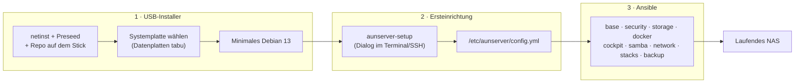

# aunserver – Projektplan

Ein USB-Stick, der jederzeit ein fertiges NAS installiert: aktuelles Debian, Docker mit Verwaltung und Überwachung, Samba-Freigaben per Weboberfläche, Servarr-Medienstack (Usenet), Netzwerk-Apps und eine sichere Grundkonfiguration.

Stand: 2026-10-17 · Status: Planung (Neustart, ersetzt das alte Konzept)

---

## 1. Ziele und Nicht-Ziele

**Ziele**

1. **USB-Stick → laufendes NAS** in unter 30 Minuten, mit wenigen Fragen und ohne Handarbeit danach.
2. **Docker verwalten und überwachen** über eine Weboberfläche: Stacks starten, stoppen, aktualisieren, Logs ansehen, Ressourcen und Alarme.
3. **Samba sehr leicht verwalten:** Freigaben per Klick im Browser anlegen, ändern, löschen.
4. **Medien verwalten:** vollständiger Servarr-Stack für Usenet und Emby als Media-Server.
5. **Netzwerk-Apps:** VPN-Fernzugriff, DNS-Werbeblocker, Reverse Proxy mit Namen statt Ports, Startseite.
6. **Platten- und Systemüberwachung** mit Benachrichtigung.
7. **Aktuell:** stabile Basis, aber aktuelle Software dort, wo es zählt (Docker, Cockpit, Kernel optional, alle Apps).
8. **Sicher per Default:** nichts aus dem Internet erreichbar, Zugriff nur aus dem LAN oder per VPN.
9. **Hardware-unabhängig:** keine festen Gerätenamen, läuft auf dem eigenen NAS, in einer VM und bei Freunden.

**Nicht-Ziele**

- Keine eigene Distribution, keine eigenen Paketquellen.
- Kein RAID/ZFS in Version 1 (siehe offene Frage O3).
- Keine Portfreigaben im Router, kein öffentliches Hosting.
- Keine Torrents (Entscheidung: nur Usenet).
- Keine Request-Oberfläche (Seerr o. ä.), dafür kommt später eine eigene Lösung.
- Keine Mehrbenutzer-Rechteverwaltung in Version 1 (ein Admin, Samba-Benutzer per Weboberfläche).

## 2. Grundentscheidungen

| # | Thema | Entscheidung | Begründung |
|---|---|---|---|
| D1 | Basis-OS | **Debian 13 „Trixie“** (aktuell 13.7), minimal | Volle Unterstützung bis 08/2028, LTS bis 06/2030. Stabil, Samba und Cockpit sind in den Paketquellen. |
| D2 | „Möglichst aktuell“ | Basis stabil, Aktualität über **Docker CE aus dem Upstream-Repo**, **Cockpit aus trixie-backports**, optional **Backports-Kernel** (neue Hardware), alle Apps als Container | Ein Rolling Release als NAS-Basis bringt Bruchrisiko ohne echten Nutzen, denn die Apps laufen ohnehin in Containern. |
| D3 | Installer | Offizielles **netinst-ISO plus Preseed**, umgebaut zu einem eigenen ISO, das Repo liegt auf dem Stick | Pakete kommen beim Installieren frisch vom Mirror, der Stick veraltet also nicht. Das Repo auf dem Stick macht den Ablauf unabhängig von GitHub. |
| D4 | Konfiguration | **Ansible lokal** (`-c local`), eine Datei `/etc/aunserver/config.yml` | Idempotent, jederzeit erneut ausführbar, kein Agent nötig. |
| D5 | Verwaltungsoberfläche | **Cockpit** (System, Platten, Updates, Terminal) mit Plugins **file-sharing** (Samba), **navigator** (Dateien), **identities** (Benutzer) | Läuft auf dem Host und bleibt deshalb erreichbar, auch wenn Docker nicht läuft. |
| D6 | Samba | **Weboberfläche ist führend** (Cockpit file-sharing, Samba-Registry). Ansible legt nur Grundkonfiguration und Start-Shares an und überschreibt danach nichts mehr | Gewünscht: „sehr leicht verwalten“. Wiederherstellbar durch Backup des Registry-Exports (`net conf list`). |
| D7 | Docker-Verwaltung | **Dockge** | Leichtgewichtig, ideal für einen Host, arbeitet direkt mit `compose.yaml`. Alternative bei Bedarf: Arcane. |
| D8 | Stacks | Mitgelieferte Stacks rendert Ansible aus Vorlagen nach `/opt/stacks/<name>`. **Eigene Stacks** legst du frei in Dockge an, Ansible fasst sie nie an | Klare Grenze zwischen „gehört dem Projekt“ und „gehört dir“. |
| D9 | Monitoring | **Beszel** (Host und Container: CPU, RAM, Netz, Temperaturen, Alarme), **Scrutiny** (SMART), **Dozzle** (Logs), **ntfy** (Push-Benachrichtigung) | Alles leichtgewichtig, auch für schwache NAS-CPUs geeignet. |
| D10 | Zugriff auf Web-Apps | **Caddy** als Reverse Proxy, alle Apps unter `https://<app>.<domain>`, Container-Ports nur an `127.0.0.1` gebunden | Löst nebenbei das Problem, dass Docker die Host-Firewall umgeht. |
| D11 | DNS | **AdGuard Home** als DNS für das Heimnetz, mit Rewrite `*.<domain>` → NAS-IP | Werbeblocker und lokale Namen in einem Dienst. |
| D12 | Fernzugriff | **Tailscale** auf dem Host (Default) oder **WireGuard** (wg-easy), per Config wählbar | Tailscale braucht keine Portfreigabe, WireGuard bleibt ohne Drittanbieter. |
| D13 | Image-Versionen | **Feste Tags** in `group_vars`, **Renovate** erzeugt Update-PRs im Repo | Reproduzierbar, Updates bleiben trotzdem einfach. |
| D14 | Sprache | Deutsch (Doku, Skriptausgaben, Kommentare) | wie bisher |
| D15 | Media-Server | **Emby** | Wird heute schon genutzt. |
| D16 | App-Configs | **SSD** (`/srv/appdata`), Sicherung per restic | Schnelle SQLite-Zugriffe, die HDD darf schlafen, Configs überleben einen HDD-Ausfall. |
| D17 | HTTPS im LAN | Lokale Domain `nas.home.arpa`, Caddy mit eigener CA (`tls internal`) | Keine eigene Domain nötig. Das Stammzertifikat wird einmal pro Gerät installiert. |
| D18 | Zielhardware | AMD A4-5000, 15 GiB RAM, SSD + 3,6-TB-HDD, UEFI | Kein Transcoding: Emby nur mit Direct Play, Monitoring bewusst leichtgewichtig. |
| D19 | SMB1 für PS2/OPL | **Zweite Samba-Instanz** `smbd-legacy`: nur SMB1, eigener Port (1445), eigene Benutzerdatenbank mit Benutzer `ps2`, nur der PS2-Ordner, Firewall optional auf die IP der Konsole beschränkt. Freigaben über `config.yml`, nicht über Cockpit | SMB1 gilt in Samba global; die Hauptinstanz bleibt so bei SMB3. Das schwache NTLMv1 trifft nur ein eigenes Konto ohne Login (Spike S5). |

## 3. Architektur



**Schichten**

| Schicht | Inhalt | Ändert sich |
|---|---|---|
| USB-Image | Debian-Installer, Preseed, Plattenauswahl, Kopie des Repos | selten |
| Repo | Ansible-Rollen, Compose-Vorlagen, Skripte, Defaults | oft |
| Host-Konfiguration | `/etc/aunserver/config.yml` und Secrets | pro Maschine |
| Laufzeitdaten | App-Configs, Samba-Registry, eigene Stacks | laufend (Backup!) |
| Nutzdaten | Medien, Downloads, Freigaben | laufend |

## 4. Funktionsumfang

### 4.1 Plattform (immer installiert)

| Dienst | Zweck | Ort |
|---|---|---|
| Cockpit + file-sharing, navigator, identities | System, Platten, Updates, Samba, Dateien, Benutzer | Host, `:9090` |
| Samba (+ `wsdd2`) | Freigaben, NAS taucht in der Windows-Netzwerkumgebung auf | Host, `:445` |
| Samba-Legacy *(optional)* | SMB1-Freigabe für PS2/OPL (D19) | Host, `:1445` |
| Docker CE + Compose | Container-Laufzeit | Host |
| Caddy | Reverse Proxy, HTTPS | Container, `:80/:443` |
| Dockge | Stacks verwalten | Container |
| Homepage | Startseite mit allen Diensten und Status | Container |
| docker-socket-proxy | Nur-Lese-Zugriff auf Docker für Homepage, Dozzle und Beszel | Container |

### 4.2 Überwachung

| Dienst | Zweck |
|---|---|
| Beszel (Hub + Agent) | Host- und Container-Metriken, Verlauf, Alarme (CPU, RAM, Platte voll, Temperatur) |
| Scrutiny | SMART-Werte aller Platten, Warnung vor Ausfall |
| Dozzle | Container-Logs live im Browser |
| ntfy | Push aufs Handy für Beszel, Scrutiny, Backup-Fehler und Updates |
| Uptime Kuma *(optional)* | Erreichbarkeit der Dienste prüfen |

### 4.3 Medien (Servarr, nur Usenet)

| Dienst | Zweck |
|---|---|
| Prowlarr | Indexer zentral für alle \*arr-Apps |
| SABnzbd | Usenet-Download (entpackt selbst, Unpackerr ist nicht nötig) |
| Sonarr | Serien |
| Radarr | Filme |
| Lidarr | Musik |
| Bazarr | Untertitel |
| Recyclarr | Qualitätsprofile nach TRaSH Guides, automatisch synchronisiert |
| Emby | Media-Server (Direct Play, Medienordner beschreibbar für Cover und Metadaten) |
| Bücher *(optional)* | Readarr ist eingestellt; Audiobookshelf und/oder Calibre-Web als Ersatz, siehe O6 |

### 4.4 Netzwerk

| Dienst | Zweck |
|---|---|
| AdGuard Home | DNS fürs Heimnetz, Werbeblocker, lokale Namen |
| Tailscale *oder* wg-easy | Fernzugriff ohne Portfreigabe; Tailscale nutzt AdGuard als DNS |
| Caddy | siehe 4.1 |

Jeder Dienst lässt sich in `config.yml` einzeln ein- und ausschalten:

```yaml
apps:
  adguard: true
  tailscale: true
  wireguard: false
  uptime_kuma: false
  emby: true

# SMB1-Freigaben für PS2/OPL (D19), Pfade relativ zu /srv/data
samba_legacy:
  enabled: true
  port: 1445
  allowed_clients: []         # z. B. [192.168.1.50] = nur die PS2
  shares:
    - name: PS2SMB
      path: games/ps2
```

## 5. Datenlayout

Ausgerichtet an den TRaSH Guides. **Ein** Dateisystem für Downloads und Medien, damit Hardlinks und sofortige Verschiebungen funktionieren.

```
/srv/data/                  HDD, Label AUNDATA
├── usenet/
│   ├── incomplete/
│   └── complete/{tv,movies,music}/
├── media/{tv,movies,music,books}/
├── games/ps2/              OPL-Struktur (CD, DVD, VMC, CFG, ART, …), Gruppe ps2share, nur per SMB1-Instanz
└── shares/                 freie Samba-Freigaben (Dokumente, Fotos, …)

/srv/appdata/               SSD: Configs und Datenbanken aller Container
/opt/stacks/                SSD: compose.yaml und .env pro Stack
```

**Regeln**

- Sonarr, Radarr und Lidarr sehen `/srv/data` als `/data`, SABnzbd sieht nur `/data/usenet`.
- Alle Container laufen mit `PUID`/`PGID` des Admins und `umask 002`.
- Configs liegen auf der **SSD** (D16) und werden per restic gesichert.
- Die Datenplatte wird per **UUID** mit `nofail` eingehängt. Docker startet nur mit eingehängter Platte (`RequiresMountsFor`), und der leere Mountpoint bekommt `chattr +i`. So landet nichts versehentlich auf der SSD.
- Standard-Freigaben: `media` (lesen und schreiben) und `shares`. Weitere legst du in Cockpit an.

## 6. Sicherheit

Grundsatz: **Nichts ist aus dem Internet erreichbar.** Zugriff gibt es nur aus dem LAN oder über VPN.

| Bereich | Maßnahme |
|---|---|
| Firewall | nftables, Default **drop** eingehend. Erlaubt aus LAN und VPN: 22, 53, 80, 443, 445, 9090 (+ 3702/5357 für wsdd). Port 1445 (SMB1) nur aus dem LAN, nie per VPN, auf Wunsch nur von der PS2-IP |
| SMB1 | Nur in der getrennten Legacy-Instanz (D19), nur der PS2-Ordner, eigenes Konto `ps2` ohne Shell und mit eigenem Passwort |
| Docker vs. Firewall | Container-Ports nur an `127.0.0.1`, Zugriff ausschließlich über Caddy. Ausnahmen sind nur DNS (AdGuard) und eventuell die Emby-Discovery im LAN |
| Docker-Socket | Homepage, Dozzle und Beszel nur über **socket-proxy (read-only)**. Dockge braucht den vollen Socket, ist root-gleich und deshalb nur hinter Caddy aus dem LAN erreichbar |
| SSH | nur Schlüssel (`ssh_authorized_keys` in der Config), kein Root-Login, Passwort-Login nach der Einrichtung aus |
| Brute-Force | fail2ban für SSH (optional, Default an) |
| Konten | Root gesperrt, ein Admin mit sudo, eigenes Samba-Passwort |
| Samba | mindestens SMB3, Signing an, kein Gast-Zugriff, keine `configs`-Freigabe |
| Web-Apps | HTTPS über Caddy. Alle \*arr-Apps mit eigener Anmeldung. Optional später zentrales Login (TinyAuth/Authelia), siehe O5 |
| Updates | `unattended-upgrades` für Debian **und** Docker-Repo, Neustartfenster konfigurierbar (Default 04:00, nur bei Bedarf). Container-Updates per Renovate-PR bzw. bewusst in Dockge |
| Secrets | nie im Repo; `config.yml`, `.env`, `*.secret` in `.gitignore`, gitleaks in der CI |
| Kernel/System | AppArmor (Debian-Default) aktiv, `sysctl`-Baseline (z. B. `kernel.dmesg_restrict`, keine ICMP-Redirects) |
| Supply Chain | Image-Tags gepinnt, Fremd-Repos (Docker, 45Drives, Tailscale) mit Schlüssel im Repo, keine `curl \| sh`-Installation |

## 7. Installationsablauf

### 7.1 USB-Stick erstellen

`installer/build-iso.sh` lädt das aktuelle Debian-13-netinst-ISO, prüft die SHA256-Summe und baut daraus `aunserver-<version>.iso` mit:

- Preseed-Datei und Bootmenü-Eintrag „aunserver installieren“ (UEFI und BIOS),
- `select-disk.sh` für die Plattenauswahl,
- einer Kopie des Repos (Tag) unter `/aunserver`,
- optional einer vorbereiteten `config.yml` für eine unbeaufsichtigte Einrichtung.

Danach schreibst du das ISO mit `dd`, Ventoy oder balenaEtcher auf den Stick. Später baut die CI das ISO automatisch bei jedem Release-Tag.

### 7.2 Installation (am Gerät, Monitor und Tastatur einmalig nötig)

1. Vom Stick booten, „aunserver installieren“ wählen.
2. Abgefragt werden nur: **Hostname, Benutzername, Passwort**.
3. `select-disk.sh` sucht die Systemplatte. Ausgeschlossen werden USB-Geräte, Wechselmedien und Platten mit Label `AUNDATA`. Bevorzugt wird die kleinste SSD/NVMe. Bleibt genau ein Kandidat übrig, wird er vorgeschlagen, sonst fragt der Installer und zeigt Modell, Größe und Seriennummer.
4. **Die Bestätigung vor dem Partitionieren bleibt immer manuell.**
5. `late_command` kopiert das Repo nach `/opt/aunserver` und richtet den Hinweis für den ersten Login ein.

### 7.3 Ersteinrichtung: `aunserver-setup`

Ein Dialog (whiptail) direkt am Gerät oder per SSH, idempotent und jederzeit erneut ausführbar:

1. Datenplatte wählen (Systemplatte wird ausgeblendet). Bei vorhandenem `AUNDATA` wird nur eingehängt, sonst formatiert, aber erst **nach Eintippen des Gerätenamens**. Single-Disk-Modus, falls nur eine Platte da ist.
2. Domain für lokale Namen (Default `nas.home.arpa`), Zeitzone, SSH-Schlüssel.
3. Apps auswählen (Checkliste, Defaults wie in 4.4).
4. `config.yml` schreiben, Ansible ausführen.
5. Samba-Passwort setzen, Tailscale-Login-Link anzeigen.
6. Zusammenfassung: Startseite `https://home.<domain>`, Cockpit `https://<ip>:9090`, DNS-Hinweis für den Router.

**Danach im Browser:** AdGuard als DNS im Router eintragen, Caddy-Stammzertifikat einmal auf den Geräten installieren (Link auf der Startseite), Indexer in Prowlarr, Usenet-Server in SABnzbd, Bibliotheken in Emby.

## 8. Repo-Struktur

```
aunserver/
├── README.md
├── config.example.yml
├── docs/
│   ├── PLAN.md                  # dieses Dokument
│   ├── spikes.md                # Ergebnisse der Vorab-Tests
│   └── BETRIEB.md               # Bedienung, Updates, Wiederherstellung
├── installer/
│   ├── build-iso.sh
│   ├── preseed.cfg.in
│   └── select-disk.sh
├── bin/
│   └── aunserver-setup
├── ansible/
│   ├── site.yml
│   ├── group_vars/all.yml       # Defaults inkl. gepinnter Image-Tags
│   └── roles/
│       ├── base/                # Pakete, Zeitzone, zram, Updates, Backports
│       ├── security/            # SSH, nftables, fail2ban, sysctl
│       ├── storage/             # Mount, Ordner, chattr
│       ├── docker/
│       ├── cockpit/
│       ├── samba/               # Grundkonfiguration, wsdd2, Start-Shares
│       ├── network/             # Tailscale bzw. WireGuard
│       ├── stacks/              # rendert stacks/* nach /opt/stacks
│       └── backup/              # restic + Timer + ntfy bei Fehler
├── stacks/
│   ├── proxy/                   # caddy
│   ├── dns/                     # adguard
│   ├── dashboard/               # homepage, dockge, socket-proxy
│   ├── monitoring/              # beszel, scrutiny, dozzle, ntfy, uptime-kuma
│   └── media/                   # prowlarr, sabnzbd, *arr, bazarr, recyclarr, emby
├── dev/
│   └── vm-test.sh               # QEMU-Testmatrix
├── renovate.json
└── .github/workflows/
    ├── lint.yml                 # shellcheck, yamllint, ansible-lint, gitleaks
    └── release.yml              # ISO bauen bei Tag
```

## 9. Meilensteine

Risikobasiert: Unklares wird zuerst in der VM geprüft. Jeder Meilenstein ist in der VM testbar und hat Abnahmekriterien.

### M0 – Gerüst ✅
- [x] Repo-Struktur, README, `.gitignore`, Lizenz
- [x] Lint-CI (shellcheck, yamllint, ansible-lint `production`, gitleaks), Versionen gepinnt (ansible-core 2.19 wie in Debian 13)
- [x] `dev/vm-test.sh` (QEMU, UEFI/BIOS, mehrere virtuelle Platten)
- [x] Renovate-Konfiguration (GitHub-App muss einmal aktiviert werden)

**Abnahme:** CI grün, VM startet mit netinst.

### M1 – Spikes (Wegwerfcode, Ergebnisse in `docs/spikes.md`)
- [x] **S1** Cockpit-Plugins (file-sharing, navigator, identities) auf Debian 13 installierbar? Samba-Registry funktioniert? → Ja, Pakete von GitHub-Releases (gepinnt), NFS/rpcbind maskieren; Details in [spikes.md](spikes.md). Bestätigung per Klick in der Weboberfläche steht noch aus.
- [ ] **S2** Preseed: Welche Fragen erscheinen? Bleibt die Partitionsbestätigung manuell? Läuft `select-disk.sh` in der Installer-Busybox?
- [ ] **S3** AdGuard auf Port 53 neben dem Host-Resolver, Caddy mit `tls internal` und Wildcard-Namen
- [ ] **S4** Docker-Ports an `127.0.0.1` und nftables zusammen: Ist von außen wirklich nur 80/443/53 offen?

**Abnahme:** Jede Annahme bestätigt oder das Design angepasst. Fallback für S1: Plugins aus GitHub-Releases, sonst ein schlankes eigenes Samba-Webformular als späteres Teilprojekt.

### M2 – Basis-System und Sicherheit
- [ ] `site.yml`, Rollen `base`, `security`, `docker`
- [ ] Backports-Kernel optional (`kernel_backports: false`)
- [ ] Idempotenz-Test in der CI (zweiter Lauf `changed=0`)

**Abnahme:** Port-Scan aus dem LAN zeigt nur erlaubte Ports, SSH nur mit Schlüssel, zweiter Lauf ohne Änderungen.

### M3 – Speicher und Samba
- [ ] Rolle `storage` (Mount, Ordner, `chattr +i`, `RequiresMountsFor`)
- [ ] Rollen `cockpit` und `samba` (Registry-Modus, wsdd2, Start-Shares)
- [ ] Legacy-Instanz für PS2 (D19, Spike S5), Ordnerstruktur für OPL

**Abnahme:** Freigabe in Cockpit anlegen → sofort von Windows/macOS/Linux erreichbar; ohne Datenplatte bleibt Docker aus, Cockpit und SSH funktionieren. PS2 mit OPL listet und startet ein Spiel über die SMB1-Freigabe, während die Hauptinstanz SMB1 weiterhin ablehnt.

### M4 – Plattform-Stacks
- [ ] proxy, dns, dashboard, monitoring
- [ ] Homepage zeigt alle Dienste mit Status, Beszel alarmiert per ntfy

**Abnahme:** Alle Dienste unter `https://<app>.<domain>` erreichbar, Testalarm kommt aufs Handy.

### M5 – Medien-Stack
- [ ] Stack `media`, Recyclarr mit TRaSH-Profilen
- [ ] Hardlink-Test (Download → Bibliothek liefert Linkzähler 2)

**Abnahme:** Testdownload landet automatisch, umbenannt und per Hardlink in der Bibliothek, Emby zeigt ihn an und spielt ihn per Direct Play ab.

### M6 – Ersteinrichtung `aunserver-setup`
- [ ] Dialog, Plattenauswahl mit Sicherheitsabfrage, Single-Disk-Modus, App-Auswahl

**Abnahme:** Szenarien leere Platte, vorhandenes `AUNDATA`, zweiter Lauf und nur eine Platte bestanden.

### M7 – USB-Installer *(parallel ab M1/S2)*
- [ ] `select-disk.sh`, `preseed.cfg.in`, `build-iso.sh` (SHA256, `md5sum.txt`, UEFI und BIOS)
- [ ] Testmatrix in der VM (siehe 10)

**Abnahme:** Vom Stick zum fertigen NAS ohne Eingriff außer Hostname, Benutzer, Passwort, Plattenbestätigung und Setup-Dialog. Die Datenplatte wird in keinem Szenario angefasst.

### M8 – Fernzugriff und Backup
- [ ] Rolle `network` (Tailscale/WireGuard)
- [ ] Rolle `backup` (restic: `/srv/appdata`, `/opt/stacks`, `/etc/aunserver`, Samba-Registry-Export; Ziel externe Platte oder Cloud) mit ntfy bei Fehler
- [ ] Restore-Test in einer frischen VM

**Abnahme:** Neuinstallation vom Stick + Restore ergibt dasselbe System mit allen Einstellungen.

### M9 – Release
- [ ] `release.yml`: ISO bei Tag bauen, als Release-Asset
- [ ] Renovate für Image-Tags
- [ ] `docs/BETRIEB.md`
- [ ] Umstellung des echten NAS (vorher Configs des Altsystems sichern)

```
M0 → M1 ─┬→ M2 → M3 → M4 → M5 → M6 ─┬→ M8 → M9
         └→ M7 (Installer, parallel) ─┘
```

## 10. Testmatrix (VM)

| # | Boot | Platten | Erwartung |
|---|---|---|---|
| 1 | UEFI | SSD + leere HDD | SSD wird automatisch gewählt, Setup formatiert die HDD |
| 2 | BIOS | wie 1 | wie 1, GRUB auf der SSD |
| 3 | UEFI | NVMe + 2 HDDs | NVMe-Namen werden korrekt behandelt, Auswahl der Datenplatte im Setup |
| 4 | UEFI | 2 gleiche SSDs | Installer fragt und zeigt Modell und Seriennummer |
| 5 | UEFI | nur 1 Platte | Single-Disk-Modus |
| 6 | – | Setup zweimal | zweiter Lauf ändert nichts |
| 7 | – | Neustart ohne Datenplatte | Docker aus, Cockpit und SSH an, nichts landet auf der SSD |
| 8 | – | HDD mit `AUNDATA` | wird nur eingehängt, nicht formatiert |
| 9 | – | Port-Scan von außen | nur die freigegebenen Ports offen |
| 10 | – | SMB1 an Port 445 und SMB2/3 an Port 1445 | beides abgelehnt; SMB1 an 1445 mit `ps2` erlaubt |

## 11. Offene Fragen

Entschieden am 2026-10-17: Media-Server, Ort der Configs, lokale Domain und Hardware (D15–D18), keine Request-Oberfläche.

| # | Frage | Vorschlag |
|---|---|---|
| O3 | Mehrere Datenplatten? | V1: eine Datenplatte. V2 optional: mergerfs (Pool) + SnapRAID (Parität) |
| O5 | Zentrales Login vor allen Apps? | V1 nein (Apps haben eigene Anmeldung), V2 TinyAuth |
| O6 | Bücher/Hörbücher? | Audiobookshelf optional |

## 12. Risiken

| Risiko | Auswirkung | Gegenmaßnahme |
|---|---|---|
| Cockpit-Plugins: kein Trixie im 45Drives-Apt-Repo | Updates kommen nicht automatisch | Trixie-Pakete aus GitHub-Releases, Version + SHA256 in `group_vars`, Renovate meldet neue Releases (S1) |
| Preseed-Verhalten (Fragen, Bestätigung) | Installer fragt zu viel oder zu wenig | Spike S2, Testmatrix |
| Port 53 belegt | AdGuard startet nicht | Spike S3, Host-Resolver anpassen |
| Schwache CPU (A4-5000) | Emby ruckelt bei Transcoding | Direct Play, Clients mit passenden Codecs, kein Transcoding einplanen |
| Einzelne HDD ohne Redundanz | Datenverlust bei Plattenausfall | Scrutiny-Warnung, Backup der Configs, wichtige Freigaben zusätzlich sichern |
| OPL kann keinen anderen SMB-Port als 445 | PS2-Freigabe nicht erreichbar | Test mit echter PS2; Fallback: zweite IP am Host, Legacy-Instanz dort auf 445 (S5) |
| SMB1/NTLMv1 ist unsicher | Passwort von `ps2` ist mitlesbar | eigenes Wegwerf-Passwort, Konto ohne Shell, nur ein Ordner, Port nur im LAN |
| Caddy-CA auf jedem Gerät nötig | Zertifikatswarnungen | Download-Link und Anleitung je Betriebssystem auf der Startseite |
